# MSXRetroThings
<i>Some nerdy hard- and software for MSX machines</i>

When I was a child, my first computer was a <a href="https://www.msx.org/wiki/Category:SVI-3x8">SV 318 MKII</a> with a cassette recorder. But not SPECTRON or ARMOURED ASSAULT were my favorites, the expansion port and the table of its pins in the manual took my fully interest.

Unfortunatelly, I had no real clou to connect the signals to my Z80 PIO in a way that it works so I lost the fun on playing around with the hardware.

Now, 40 years later, I got a <a href="https://www.msx.org/wiki/Spectravideo_SVI-728">SVI 728</a> and a  <a href="https://www.ebay.de/sch/i.html?item=332817640567&rt=nc&_trksid=p4429486.m145687.l2562&_ssn=fractal2000">memory mapper / sd card cartridge</a> from the bay and also a <a href="https://www.8bits4ever.net/product-page/sxe-msx2-fpga-computer">SX-E MSX2+</a> and started over.

I had a lot of chips in my basket like Z80 PIO, 8255, 8254, SJA1000, PCF8584 etc. The results are several MSX cartridges, ROM code and <a href="https://rc2014.co.uk/">RC2014 cards</a> which I would like to show you here as retro and nerdy stuff for own developments or just for gambling.

Some of the software stuff comes from KONAMIMAN, especially the UNAPI structure and also the memory allocation in basic for working areas in RAM. Please have a look at his <a href="https://www.konamiman.com/msx/msx-e.html">git</a> for further information.

Have fun and stay healthy,

Thomas

## Contents

+ [1. The XIO cartridge](#1-msxretrothings---the-xio-cartridge)
+ [2. The RCX ROM cartridge and RC2014 cards](#2-msxretrothings---the-rcx-rom-cartridge-and-rc2014-cards)
+ [3. mbc89, a Maerklin Connect6021 CAN accessory module](#3-msxretrothings---mbc89-a-maerklin-connect6021-can-accessory-module)
+ [4. Tools](#4-msxretrothings---tools)
+ [5. Emulators](#5-msxretrothings---emulators)
+ [6. License](#6-license)

## 1. MSXRetroThings - The XIO cartridge

#### <b>1.1 The XIO cartridge contains these functions:</b>

+ Switched IO based on the idea of ASCII to achive 256 additional IO locations
+ 8 channel programable interrupt controller 8259 with fallen edge sensitive inputs
+ 8 channel daisy chain IM2 emulator
+ BASIC and UNAPI commands to controll the functionallities of the cartridge in on board BIOS ROM

#### <b>1.2 Impressions:</b>

XIO cartridge used in a SX-E MSX2+ with adapter to RC2014 backplane

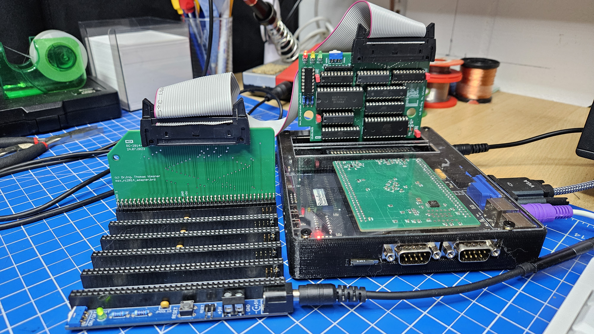

XIO cartridge

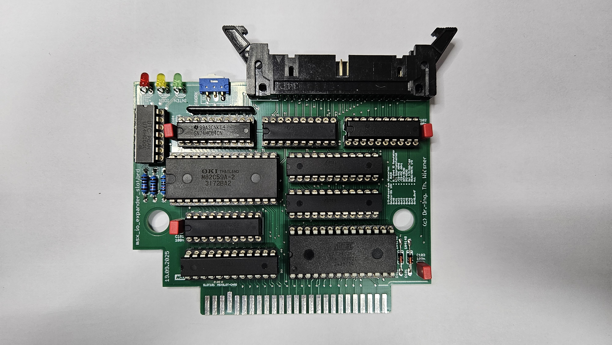

Boot message from BIOS ROM

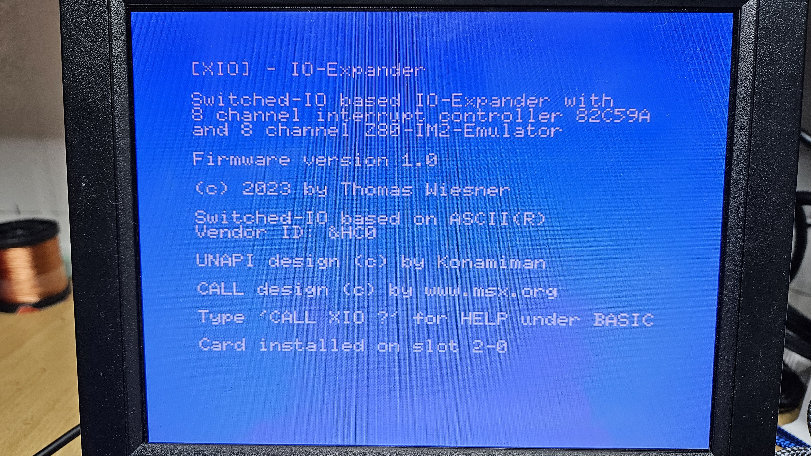

#### <b>1.3 Hardware:</b>

The schematics of XIO is strictly build up in non smd method to enable people without special tools to rebuild the pcb. But it uses GAL chips for the switched IO decoder, the glue decoder for controll signals and the address decoder.

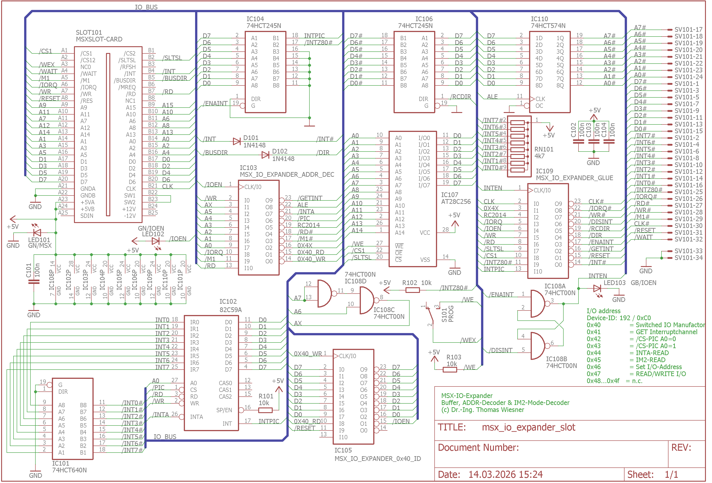

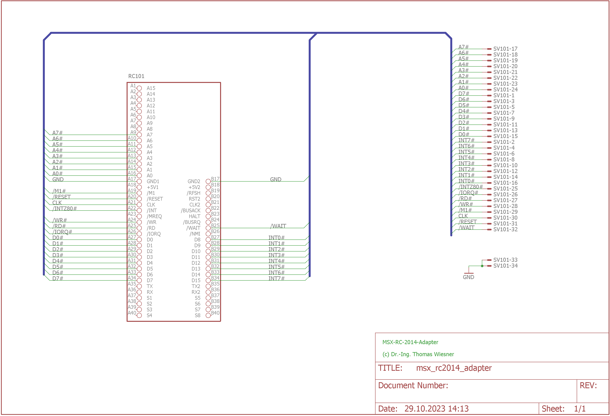

The XIO OUT/IN functions work without installing the XIO card. If the XIO card is installed correctly, the green LED shows that alle 16 interrupt channels are ready to use. A blinking yellow LED shows activities to the switched IO addresses. It signals, that the switched IO is selected via &H40 of the original MSX IO bus. The red LED shows a working supply.

#### <b>1.4 Software:</b>

The BIOS for the card functions is provided in the on board ROM (EEPROM). It contains the additional BASIC commands and an instance of UNAPI.

For SDCC developments, a library was created as bridge to the ROM.

Command reference (syntax, parameters, UNAPI numbers, SDCC functions): [xio/README.md](xio/README.md#command-reference)

[↑ Contents](#contents)

## 2. MSXRetroThings - The RCX ROM cartridge and RC2014 cards

#### <b>2.1 The RCX ROM cartridge contains these functions:</b>

+ Up to 16 RC2014 cards installable with used IO address control and 16 bytes of free RAM each card

+ BASIC, SDCC and UNAPI commands to controll the functions of the cartridge in separate BIOS ROM cartridge

+ SDCC and UNAPI commands to controll the functions of the cartridge also avaiable as Driver for MSX-DOS 2

+ [RC2014 card with PCF8584 I2C Controller (3 ports via Seeed) and PCF8583 battery buffered RTC](#a-rc2014-card-with-pcf8584-i2c-controller-3-ports-via-seeed-and-pcf8583-battery-buffered-rtc)

+ [RC2014 card with SJA1000 CAN controller (single use only)](#e-rc2014-card-with-sja1000-can-controller-single-use-only)

+ [RC2014 card with 8255A PIO](#c-rc2014-card-with-8255a-pio)

+ [RC2014 card with 8254A CTR](#d-rc2014-card-with-8254a-ctr)

+ [RC2014 card with 4x SPI bus up to 2 MHz via ATMEGA8](#f-rc2014-card-with-4x-spi-bus-up-to-2-mhz-via-atmega8)

+ [RC2014 card with ADS1220 4 channel 24 bit A/D converter via ATMEGA8](#g-rc2014-card-with-ads1220-4-channel-24-bit-ad-converter-via-atmega8)

+ [RC2014 card with MCP4822 4 channel 12 bit D/A converter via ATMEGA8](#i-rc2014-card-with-mcp4822-4-channel-12-bit-da-converter-via-atmega8)

+ [RC2014 card SC103 with Z80 PIO](#b-rc2014-card-sc103-with-z80-pio)

+ [RC2014 card SC725 with Z80 SIO and Z80 CTC](#h-rc2014-card-sc725-with-z80-sio-and-z80-ctc)

The schematics of RC2014 cards are strictly build up in non smd method to enable people without special tools to rebuild the pcb.

#### <b>2.2 Impressions:</b>

Slot ROM

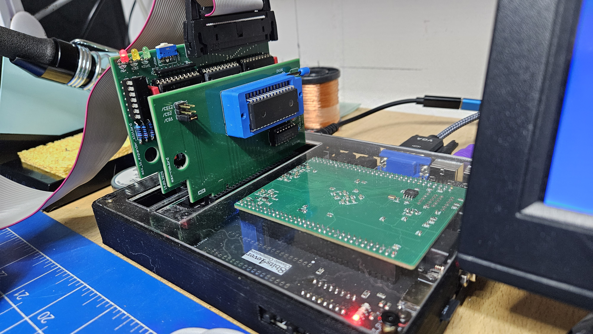

Boot message from BIOS ROM

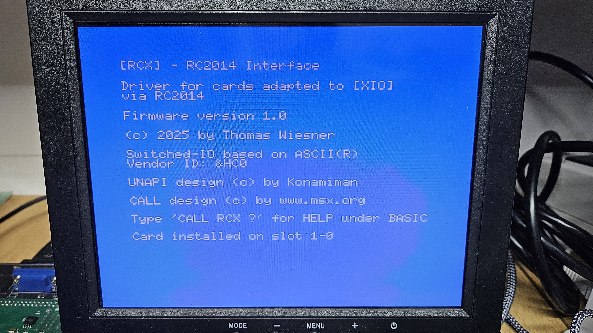

#### <b>2.3 Hardware:</b>

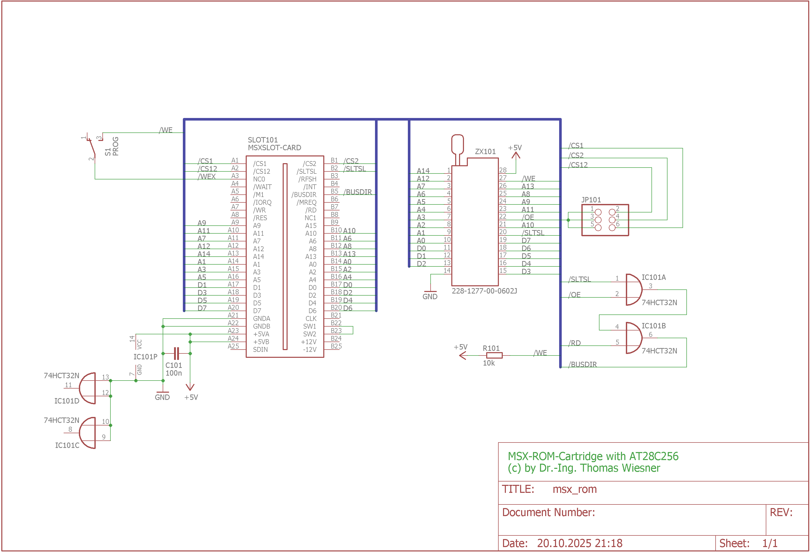

#### <b>2.4 Software:</b>

The BIOS for the card functions is provided in the on board ROM (EEPROM). It contains the additional BASIC commands and an instance of UNAPI.

As a software-only alternative to the physical ROM cartridge, [`RCXRAM.COM`](rcx/rc2014_rom+ram/drv/RCXRAM.COM) installs the same `RCX_INTERFACE` UNAPI driver into mapped RAM at runtime instead of requiring a burned EEPROM - useful for testing and development without the actual cartridge. It is UNAPI/EXTBIOS-only (no BASIC `CALL` support, since that relies on BASIC's own boot-time scan of ROM header slots, which does not apply to a RAM segment). Covers all card types A through G.

For SDCC developments, a library was created as bridge to the ROM/DRV.

Command reference (syntax, parameters, UNAPI numbers, SDCC functions): [rcx/README.md](rcx/README.md#command-reference)

## A) RC2014 card with PCF8584 I2C Controller (3 ports via Seeed) and PCF8583 battery buffered RTC:

This RC2014 card contains an I2C bus controller PCF8584 and a PCF8583 RTC buffered by battery. The interrupt pins of both chips can be assigned to one of the XIO PIC interrupt channels.
Up to 16 cards of this type are possible.

#### <b>A.1 Impressions:</b>

RC2014 card on backplane

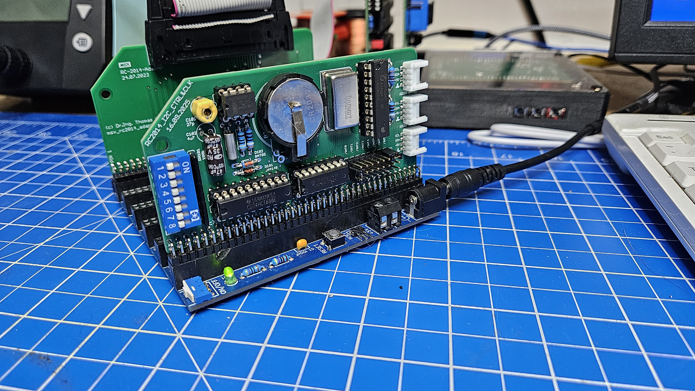

RC2014 card on backplane with I2C LCD from Seeed

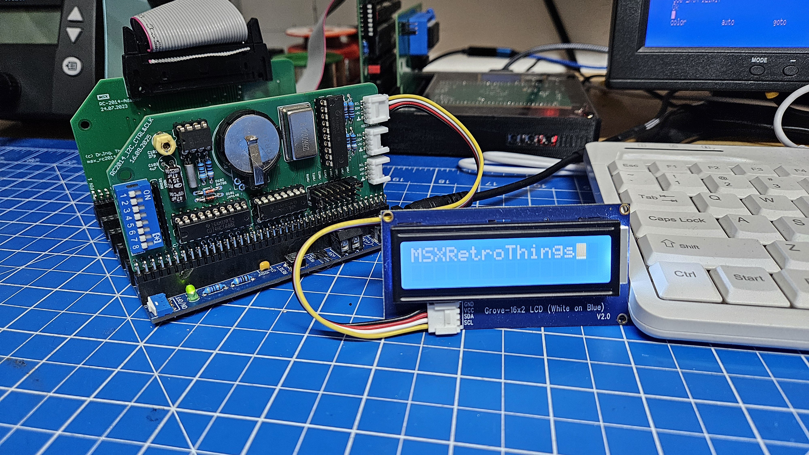

RC2014 card on backplane contacted via BASIC to get TIME and DATE

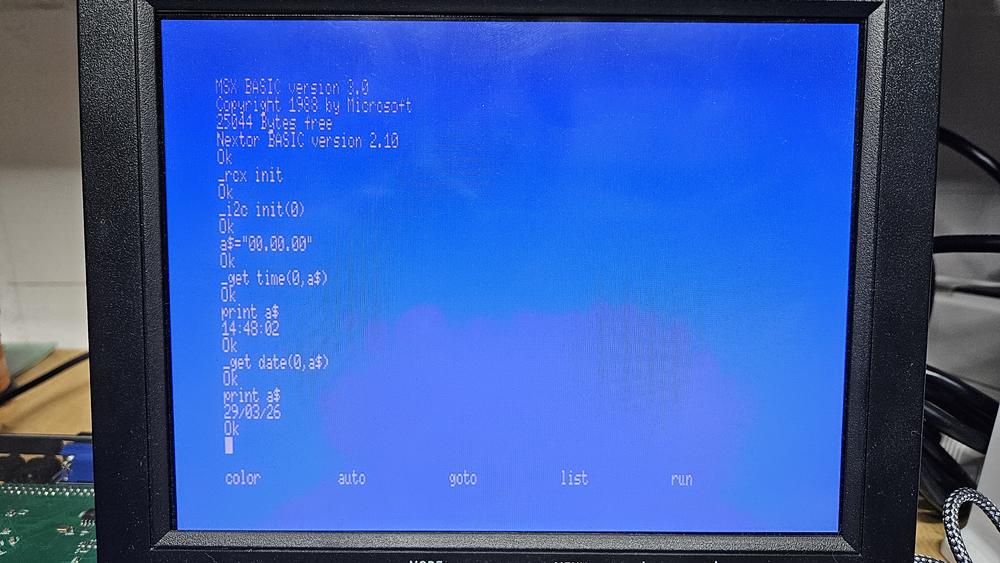

#### <b>A.2 Hardware:</b>

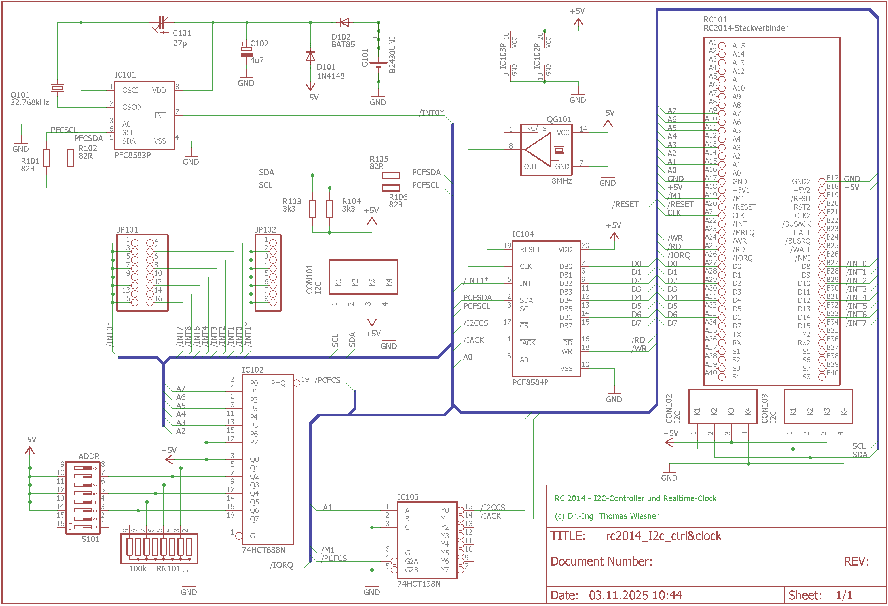

#### <b>A.3 Software:</b>

The BIOS for the card functions is provided in the RCX slot ROM. It contains the additional BASIC commands (`I2C INIT/WR/WRB/RD/RDB/RESET`, `SET/GET TIME/DATE`) and an instance of UNAPI, so the same functions are callable directly via UNAPI/EXTBIOS from a `.COM` program without the BASIC interpreter. Test software exists both as interactive BASIC programs and as `.COM` tools, including a variant that keeps the SEED I2C LCD updated on every PIC interrupt and one that stays resident in memory (MemMan TSR) to keep updating the display in the background.

Command reference (syntax, parameters, UNAPI numbers, SDCC functions): [rcx/rc2014_card_a/README.md](rcx/rc2014_card_a/README.md#command-reference)

[↑ 2.1](#21-the-rcx-rom-cartridge-contains-these-functions)

## B) RC2014 card SC103 with Z80 PIO

The ROM of RCX contains BASIC and UNAPI commands to steer SC103 from original RC2014 manufactor.

#### <b>B.1 Impressions:</b>

RC2014 card on backplane

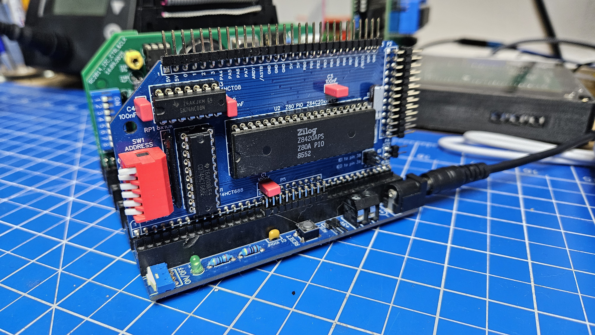

#### <b>B.2 Hardware:</b>

Please visit RC2014 homepage for further information

#### <b>B.3 Software:</b>

The BIOS for the card functions is provided in the RCX slot ROM. It contains the additional BASIC commands (`PIO INIT`, `PIO A/B RD/WR`, `PIO A/B CTRL`) and an instance of UNAPI, so the same functions are callable directly via UNAPI/EXTBIOS from a `.COM` program without the BASIC interpreter. A second test program drives Port B in the Z80 PIO's own IM2 interrupt mode, with a small Z80 machine code service routine registered through `XIO SET ADDR` that reports which channel fired.

Command reference (syntax, parameters, UNAPI numbers, SDCC functions): [rcx/rc2014_card_b/README.md](rcx/rc2014_card_b/README.md#command-reference)

[↑ 2.1](#21-the-rcx-rom-cartridge-contains-these-functions)

## C) RC2014 card with 8255A PIO

RC2014 card with a 8255 PIO. Up to 16 cards are possible. The interrupt pins of PORT C can be assigned to one of the XIO PIC interrupt channels.

#### <b>C.1 Impressions:</b>

RC2014 card on backplane

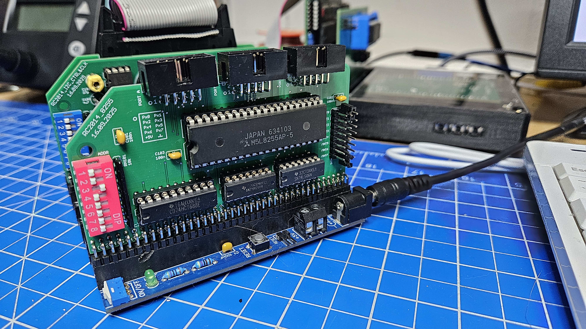

#### <b>C.2 Hardware:</b>

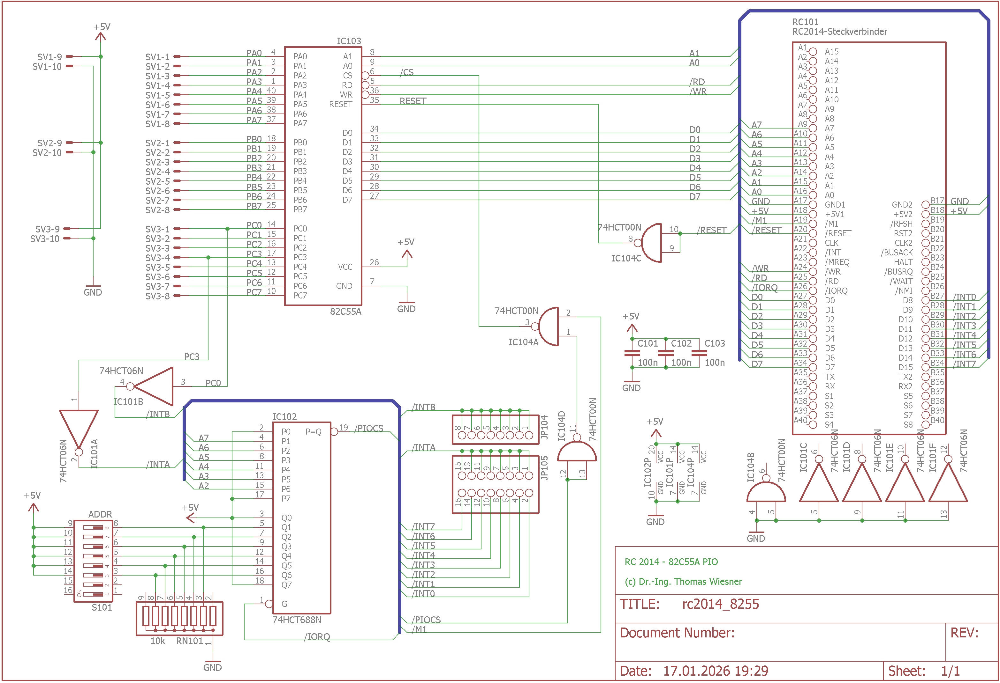

#### <b>C.3 Software:</b>

The BIOS for the card functions is provided in the RCX slot ROM. It contains the additional BASIC commands (`PPI INIT`, `PPI A/B/C RD/WR`, `PPI CTRL`, `PPI SET/RESET`) and an instance of UNAPI, so the same functions are callable directly via UNAPI/EXTBIOS from a `.COM` program without the BASIC interpreter. A second test program runs Port B in Mode 1 (strobed input), where the 82C55 itself raises `INTR B` on PC0 - reported through XIO's standard interrupt handler, no custom service routine needed.

Command reference (syntax, parameters, UNAPI numbers, SDCC functions): [rcx/rc2014_card_c/README.md](rcx/rc2014_card_c/README.md#command-reference)

[↑ 2.1](#21-the-rcx-rom-cartridge-contains-these-functions)

## D) RC2014 card with 8254A CTR

RC2014 card with a 8254 CTR. Up to 16 cards are possible. The interrupt pins of TIMER 0 and 1 can be assigned to one of the XIO PIC interrupt channels. This module does not work with internal clock if 8253 (max. 1 MHz) is used.

#### <b>D.1 Impressions:</b>

RC2014 card on backplane

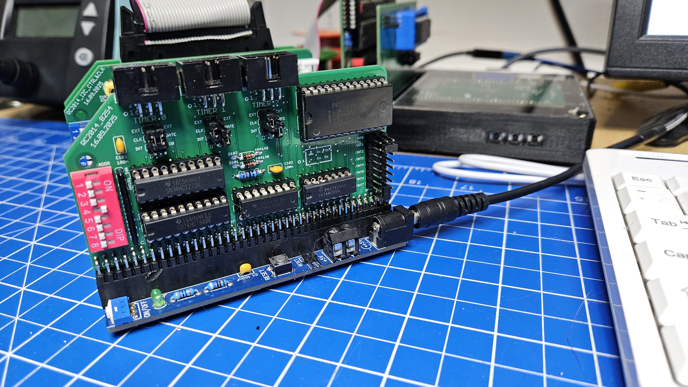

#### <b>D.2 Hardware:</b>

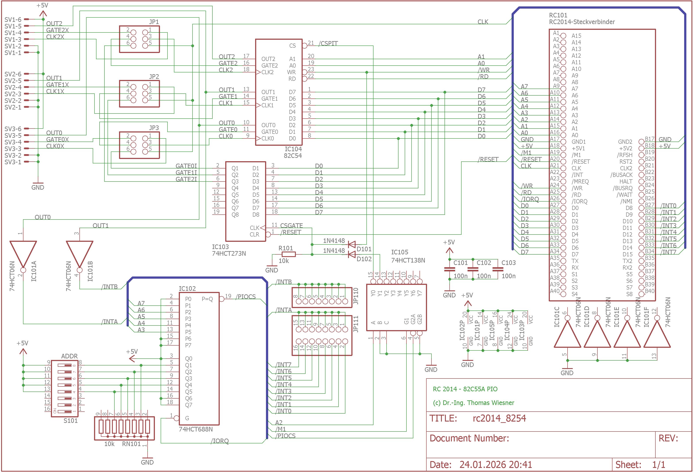

#### <b>D.3 Software:</b>

The BIOS for the card functions is provided in the RCX slot ROM. It contains the additional BASIC commands (`TIMER INIT`, `TIMER 0/1/2 RD/WR`, `TIMER CTRL`, `TIMER SET/RESET GATE`) and an instance of UNAPI, so the same functions are callable directly via UNAPI/EXTBIOS from a `.COM` program without the BASIC interpreter. A second test program wires one of the counter outputs to a PIC interrupt channel and keeps a running interrupt count on screen.

Command reference (syntax, parameters, UNAPI numbers, SDCC functions): [rcx/rc2014_card_d/README.md](rcx/rc2014_card_d/README.md#command-reference)

[↑ 2.1](#21-the-rcx-rom-cartridge-contains-these-functions)

## E) RC2014 card with SJA1000 CAN controller (single use only)

RC2014 card with SJA1000 CAN controller and RJ45 sockets with automatic termination function. The software provides PELICAN Mode and 250 kBit/s.

Only one card is possible due to RAM allocation and interrupt handling. The interrupt pin of the SJA1000 can be assigned to one of the XIO PIC interrupt channels.

#### <b>E.1 Impressions:</b>

RC2014 card on backplane

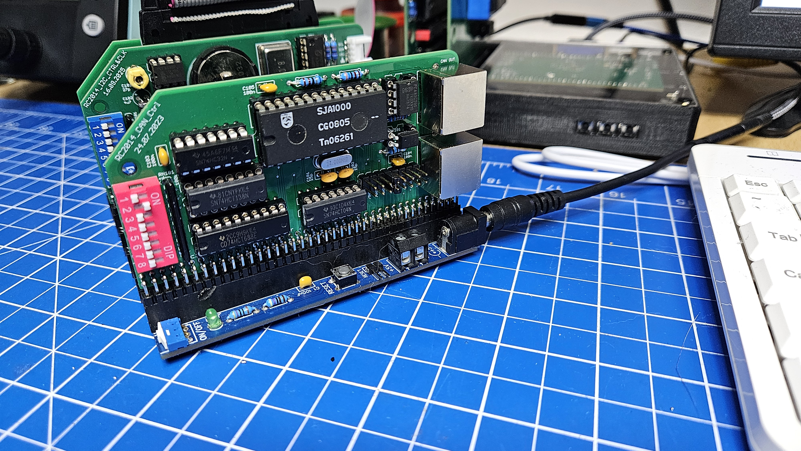

#### <b>E.2 Hardware:</b>

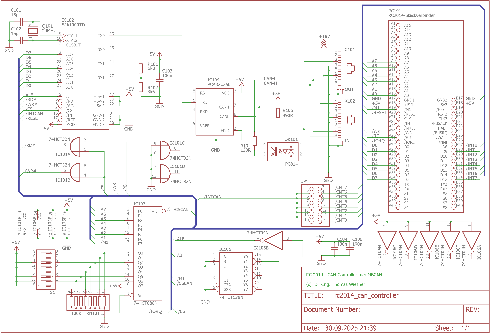

#### <b>E.3 Software:</b>

The BIOS for the card functions is provided in the RCX slot ROM. It contains the additional BASIC commands (`CAN INIT`, `CAN WR/RD`, `CAN CHECK/RX/TX`, `CAN GET ADDR`) and an instance of UNAPI, so the same functions are callable directly via UNAPI/EXTBIOS from a `.COM` program without the BASIC interpreter. The test program receives and sends CAN messages interrupt-driven, e.g. for a Maerklin CS3 bus, by registering the ROM's own CAN service routine (returned by `CAN GET ADDR`) directly through `XIO SET ADDR` - no custom interrupt code needed.

Command reference (syntax, parameters, UNAPI numbers, SDCC functions): [rcx/rc2014_card_e/README.md](rcx/rc2014_card_e/README.md#command-reference)

[↑ 2.1](#21-the-rcx-rom-cartridge-contains-these-functions)

## F) RC2014 card with 4x SPI bus up to 2 MHz via ATMEGA8

RC2014 card with 4 SPI busses selectable via software with baudrate up to 2 MHz. Up to 16 SPI cards are possible. The interrupt pin of the ATMEGA8 can be assigned to one of the XIO PIC interrupt channels.

#### <b>F.1 Impressions:</b>

RC2014 card on backplane

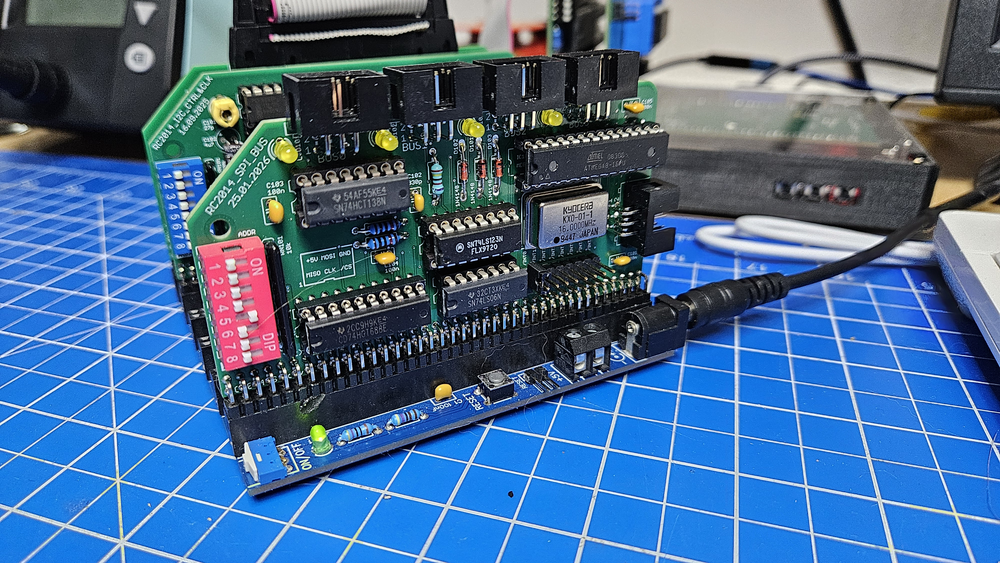

#### <b>F.2 Hardware:</b>

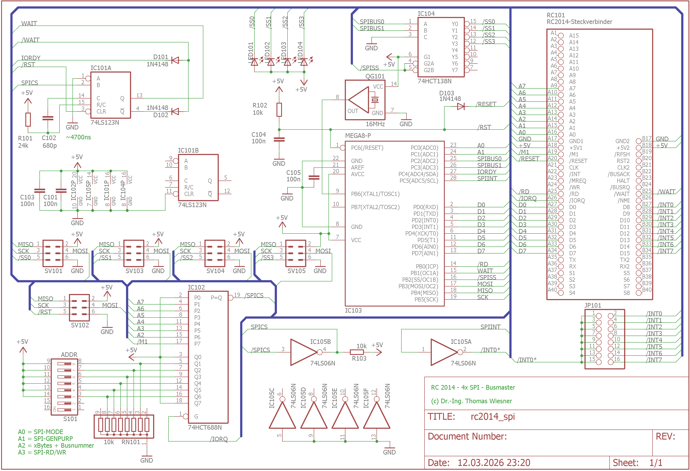

#### <b>F.3 Software:</b>

The BIOS for the card functions is provided in the RCX slot ROM. It contains the additional BASIC commands (`SPI INIT/MODE`, `SPI WR/WRB/RD/RDB/RDH`) and an instance of UNAPI, so the same functions are callable directly via UNAPI/EXTBIOS from a `.COM` program without the BASIC interpreter. Up to 4 independent SPI busses are addressable per card; the test program exercises a MCP23S17 GPIO expander as a Port A/B loopback test.

Command reference (syntax, parameters, UNAPI numbers, SDCC functions): [rcx/rc2014_card_f/README.md](rcx/rc2014_card_f/README.md#command-reference)

[↑ 2.1](#21-the-rcx-rom-cartridge-contains-these-functions)

## G) RC2014 card with ADS1220 4 channel 24 bit A/D converter via ATMEGA8

RC2014 card with ADS1220 module. Up to 16 cards are possible. The interrupt pin of ATMEGA8 can be assigned to one of the XIO PIC interrupt channels.

#### <b>G.1 Impressions:</b>

RC2014 card on backplane

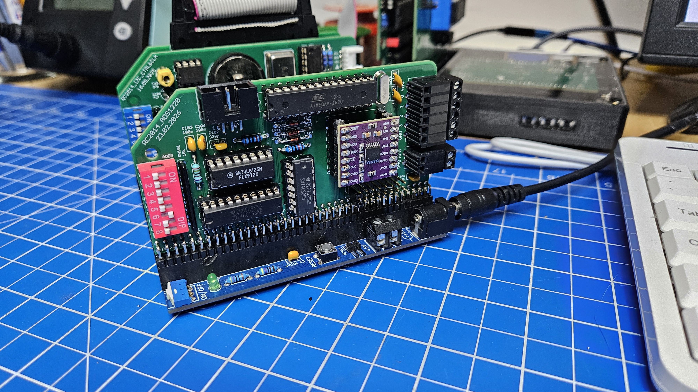

#### <b>G.2 Hardware:</b>

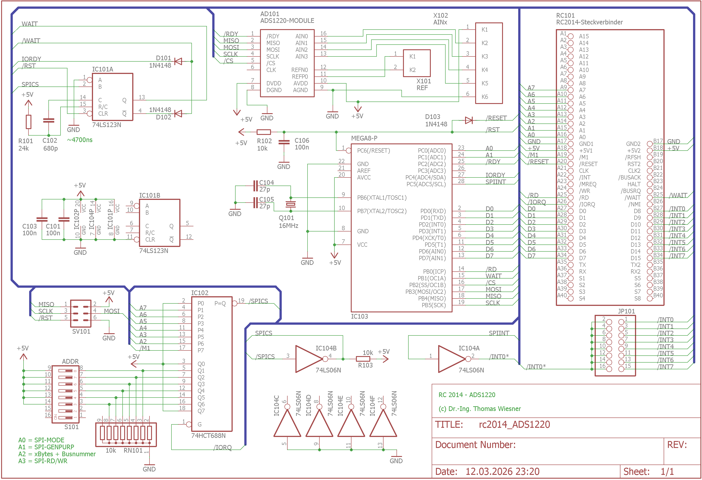

#### <b>G.3 Software:</b>

The BIOS for the card functions is provided in the RCX slot ROM. It contains the additional BASIC commands (`ADS INIT/MODE/CMD/STATUS/READ/GET`) and an instance of UNAPI, so the same functions are callable directly via UNAPI/EXTBIOS from a `.COM` program without the BASIC interpreter. `ADS GET` automates the whole measurement sequence (set MODE, start conversion, select channel, read all 4 RESULT bytes) into a single native `SNG` float value.

Command reference (syntax, parameters, UNAPI numbers, SDCC functions): [rcx/rc2014_card_g/README.md](rcx/rc2014_card_g/README.md#command-reference)

[↑ 2.1](#21-the-rcx-rom-cartridge-contains-these-functions)

## H) RC2014 card SC725 with Z80 SIO and Z80 CTC

The ROM of RCX contains BASIC and UNAPI commands to steer SC725 from original RC2014 manufactor.

#### <b>H.1 Impressions:</b>

RC2014 card on backplane

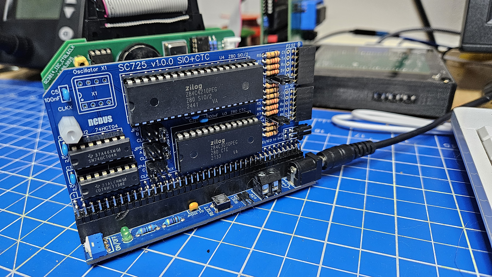

Details coming soon. Card page: [rcx/rc2014_card_h/README.md](rcx/rc2014_card_h/README.md)

[↑ 2.1](#21-the-rcx-rom-cartridge-contains-these-functions)

## I) RC2014 card with MCP4822 4 channel 12 bit D/A converter via ATMEGA8

RC2014 card with 2x MCP4822. Up to 16 cards are possible. The interrupt pin of ATMEGA8 can be assigned to one of the XIO PIC interrupt channels.

#### <b>I.1 Hardware:</b>

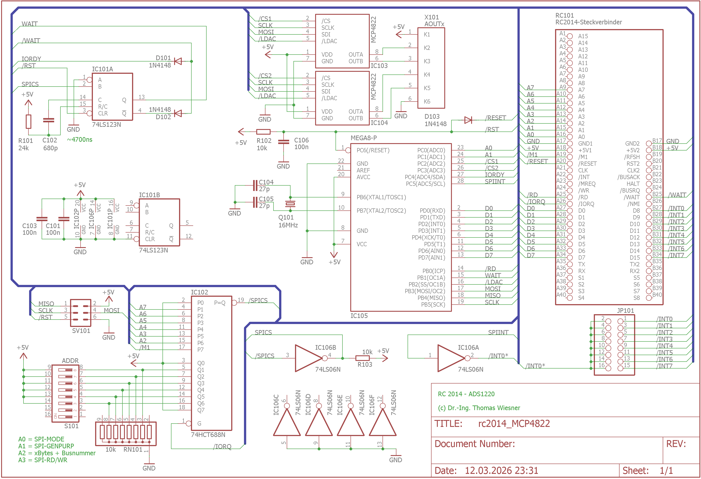

Details coming soon. Card page: [rcx/rc2014_card_i/README.md](rcx/rc2014_card_i/README.md)

[↑ 2.1](#21-the-rcx-rom-cartridge-contains-these-functions)

[↑ Contents](#contents)

## 3. MSXRetroThings - mbc89, a Maerklin Connect6021 CAN accessory module

#### <b>3.1 mbc89 provides:</b>

+ A full MSX-DOS 2 port of `mbc89`, one of the MBCAN family of Maerklin CS2/CS3 CAN-bus accessory modules - runs as a normal `.COM` program instead of the original's ATmega firmware

+ Runs on MSX1, MSX2, and MSX2+ alike - graphics use only the TMS9918A-standard SCREEN0/SCREEN2 modes, backward-compatible on every later VDP (V9938/V9958); the only real requirement is an MSX-DOS 2 kernel (needed for the environment-variable-based startup configuration), not a particular machine generation

+ Registers itself on the CS2/CS3 CAN bus exactly like a real Connect6021 and answers the config-channel walk (SW version, central-station-type mapping, keyboard base address, I2C clock)

+ Simulates up to 16 Keyboard-6040 keyboards, one CU6021 control unit, and up to 8 Control80f control units, all as one switchable on-screen panel (carousel, `SPACE` to switch)

+ Bidirectional CAN wiring on every panel: a button press sends a real CAN message, an incoming CAN message updates the panel's LEDs/knob live

+ Startup configuration via MSX-DOS 2 environment variables, persisted configuration (GUiD, PC database number, SW version, mapping, base address, I2C clock, module name) via a file-based EEPROM replacement (`MBC89.CFG`)

+ Built on the [XIO cartridge](xio/) (switched IO/IM2/PIC) and the [RCX ROM cartridge](rcx/)'s `RC2014 card E` (SJA1000 CAN controller)

#### <b>3.2 Impressions:</b>

Splash screen

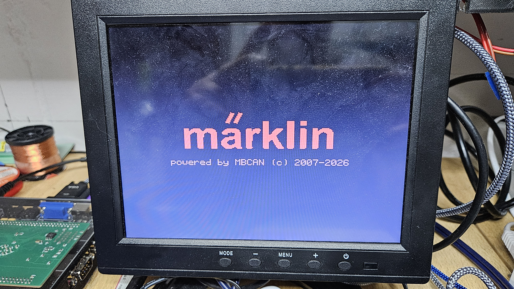

Boot info screen - startup configuration, persisted configuration, and discovery/init results

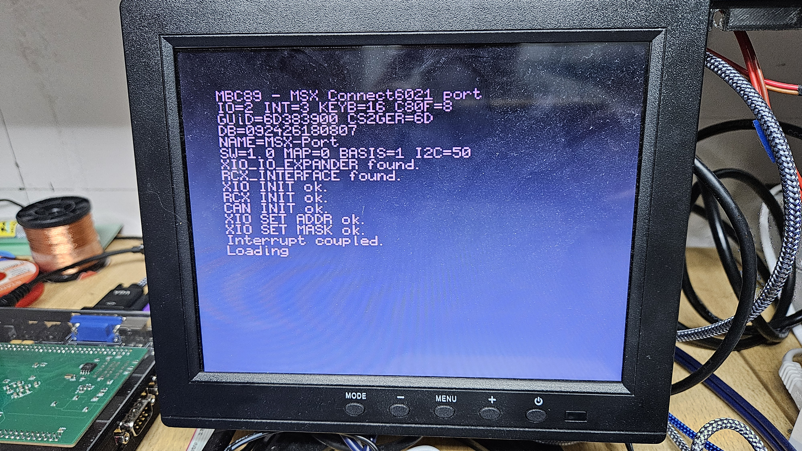

CU6021 panel - locomotive control (speed knob, direction toggle, functions F0-F4), one instance - original Maerklin device (left) vs. mbc89 emulation (right)

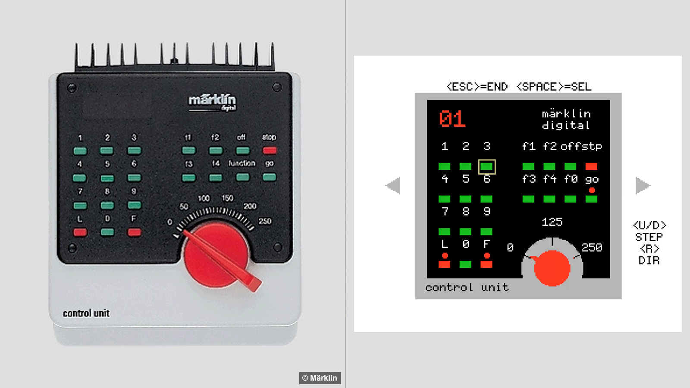

Keyboard-6040 panel - accessory control (a grid of red/green switch/signal button pairs for turnouts and signals), up to 16 independent instances - original Maerklin device (left) vs. mbc89 emulation (right)

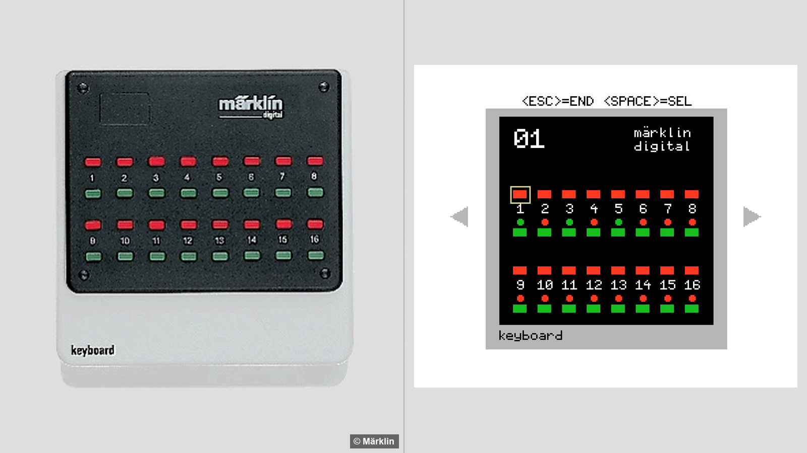

Control80f panel - a second locomotive controller alongside CU6021, same speed/direction/function control, up to 8 independent instances - original Maerklin device (left) vs. mbc89 emulation (right)

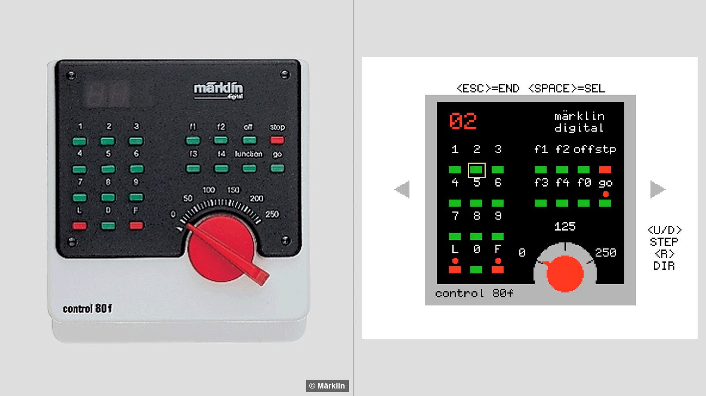

A full startup-to-panel video is included: [`mbc89/images/startup.mp4`](mbc89/images/startup.mp4).

#### <b>3.3 Hardware:</b>

No dedicated hardware - runs on any MSX1/MSX2/MSX2+ with `RC2014 card E` (SJA1000 CAN controller, see [`rcx/rc2014_card_e/`](rcx/rc2014_card_e/)) installed behind an XIO cartridge+RC2014 adapter, connected to a Maerklin CS2/CS3 CAN bus, and MSX-DOS 2 as the active kernel.

#### <b>3.4 Software:</b>

For SDCC development, the module is built with [MSXgl](https://github.com/aoineko-fr/MSXgl) against the same `xio_io`/`rcx_io`/`dostools` libraries the XIO and RCX SDCC tools use. Full source, build configuration, a prebuilt `.com`, and rebuild instructions are in [`mbc89/`](mbc89/) - see [`mbc89/README.md`](mbc89/README.md) for details.

[↑ Contents](#contents)

## 4. MSXRetroThings - Tools

#### <b>4.1 SVI3x8 TXT-CAS Converter</b>

Two Python scripts for the Spectravideo SVI-318/328: `svi_txt_to_cas.py` turns a numbered BASIC listing in a TXT file into a cassette image that BASIC loads with `LOAD "CAS:NAME"`, and `svi_cas_to_txt.py` turns the BASIC programs of a cassette image (`CSAVE` tokenized or `SAVE` ASCII) back into TXT listings. Only Python 3 is needed. Usage, formats and tests: [tools/svi3x8_txt_cas/README.md](tools/svi3x8_txt_cas/README.md).

#### <b>4.2 SVI3x8 CP/M 2.24 Disk Builder</b>

A Python script that builds a bootable Spectravideo CP/M 2.24 system disk for the SVI-328 with an SVI-605B from the CP/M 2.2 sources of Digital Research, the Spectravideo CP/M BIOS 2.24 and the boot sector of a CP/M 2.27 disk. The disk also carries the standard CP/M programs and a FORMAT.COM of its own. The Spectravideo parts are not included; you supply them, and the README lists their SHA1 checksums. Details: [tools/svi3x8_cpm224/README.md](tools/svi3x8_cpm224/README.md).

#### <b>4.3 SVI3x8 to MSX Game Porter</b>

A Python tool that ports Spectravideo SVI-318/328 cassette games to MSX: from the original SVI cassette it builds MSX cassette files (`BLOAD"CAS:",R`) and cartridge ROMs. Each game is a recipe with a checked patch table (SVI I/O ports to MSX ports, keyboard and joysticks through small helper routines); recipes exist for Alien 8, Arkanoid, Armoured Assault, Donkey Kong and Spectron. A scanner lists the SVI hardware accesses of a new game as a starting point. The games themselves are not included; you need your own original cassettes. Details: [tools/svi3x8_msx_port/README.md](tools/svi3x8_msx_port/README.md).

[↑ Contents](#contents)

## 5. MSXRetroThings - Emulators

My first computer was an SVI-318; the cards and ROMs above were written for an SVI-728 and an MSX2+. To try them, and the software of that time, at the timing of the real machines, four Windows emulators grew alongside: SVI-318, SVI-328, SVI-728 and Philips VG-8235. They step the Z80 T-state by T-state and run every chip on the same master clock; the chips are shared libraries with their own tests, built from the data sheets. Each emulator has a user manual, a Windows setup and a video recorder (MP4) for picture and sound.

Overview, building and ROM notes: [emu/README.md](emu/README.md). The original ROM images are not included; the manuals name the files and their SHA1 checksums.

Click a picture to open the video.

#### <b>5.1 Spectravideo SVI-318</b>

The SVI-318 with 16 KiB RAM and BASIC 1.11, PAL or NTSC, cassette, modules, the expanders SVI-601, SVI-602, SVI-605B (also with hard disk) and SVI-608M with all their cards: disk controller, Centronics, RAM, RS-232, 80 columns, SASI hard disk and boot card. Left: start into BASIC. Right: the SVI-608M with SVI-806 80-column card and an SVI-807 64 KB RAM card boots CP/M 2.27 from the hard disk; the 80-column screen appears in the green panel beside the TV picture.

<a href="emu/svi318/media/SVI318_BASIC.mp4">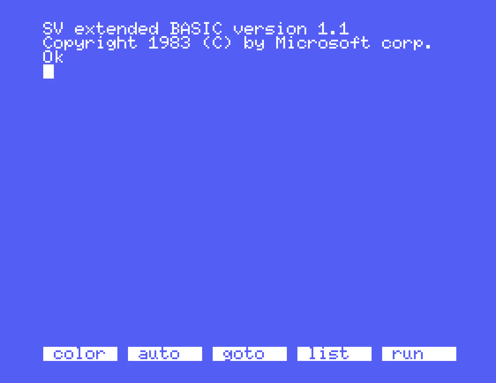</a> 

Manual: [MANUAL.md](emu/svi318/Distribution/MANUAL.md), project: [emu/svi318](emu/svi318/README.md)

#### <b>5.2 Spectravideo SVI-328</b>

The SVI-328 with 64 KiB RAM: everything of the SVI-318, plus the SVI-609 Master Station with its LAN card. Left: start into BASIC. Right: CP/M 2.27 from the hard disk of the SVI-608M, console on the SVI-806 80-column card.

 <a href="emu/svi328/media/SVI328_CPM227_HDD_80col.mp4">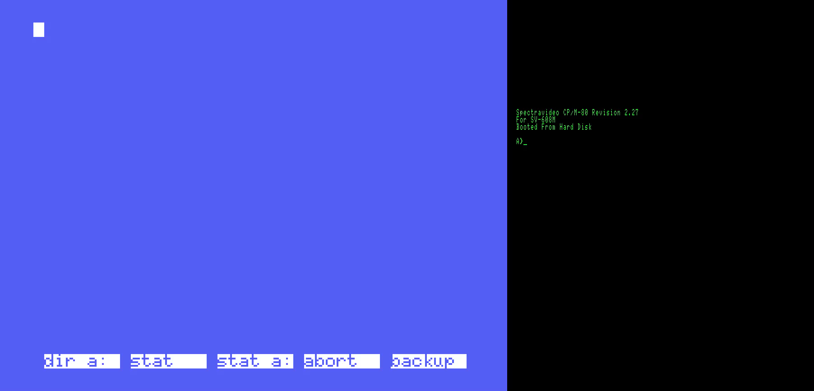</a>

Manual: [MANUAL.md](emu/svi328/Distribution/MANUAL.md), project: [emu/svi328](emu/svi328/README.md)

#### <b>5.3 Spectravideo SVI-728</b>

The SVI-728, Spectravideo's MSX1, PAL or NTSC, with cassette, two module slots with the common MegaROM mappers and printer output to files. The video shows the start into MSX BASIC.

<a href="emu/svi728/media/SVI728_BASIC.mp4">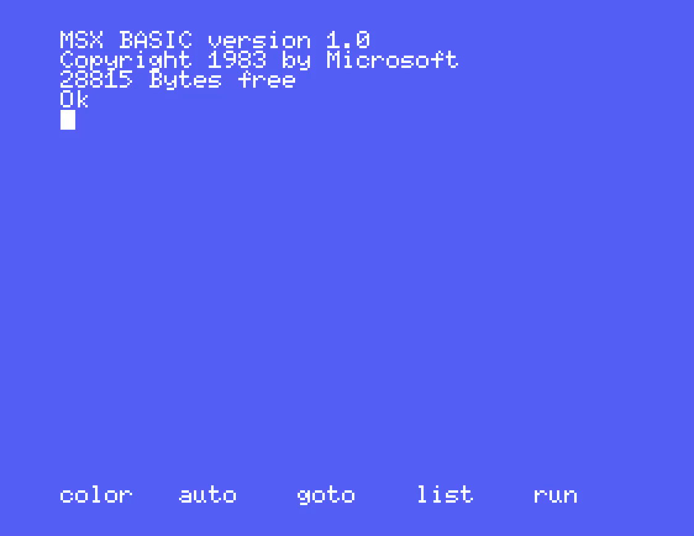</a>

Manual: [MANUAL.md](emu/svi728/Distribution/MANUAL.md), project: [emu/svi728](emu/svi728/README.md)

#### <b>5.4 Philips VG-8235</b>

The Philips VG 8235/00, an MSX2 with V9938 video chip (all screen modes, command unit), 3.5" disk drive with WD2793 controller, real-time clock with CMOS memory, cassette, two module slots and printer. The video shows the start into Disk BASIC.

<a href="emu/vg8235/media/VG8235_BASIC.mp4">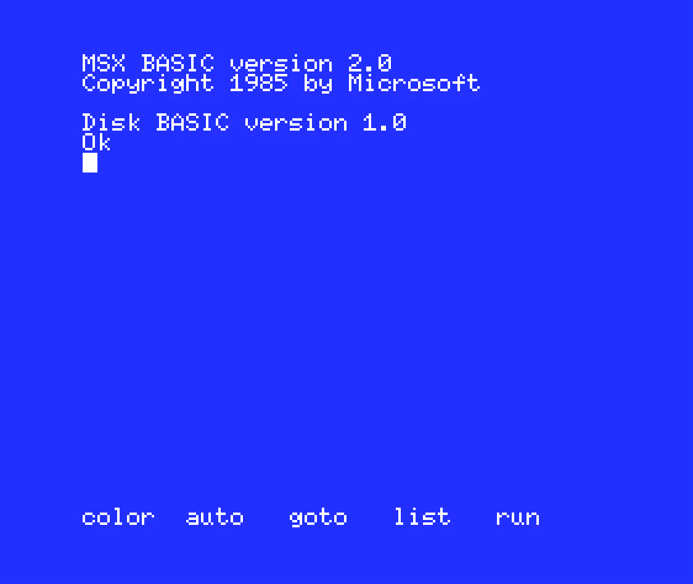</a>

**Special application: an SVI game on MSX.** The [SVI3x8 to MSX game porter](#43-svi3x8-to-msx-game-porter) turns the SVI-318/328 cassette of Spectron (Spectravideo, 1983) into a plain 16 KiB MSX cartridge. Here the VG-8235 starts with that module, shows the menu, starts a game with key `1` and plays a round: the SVI hardware accesses of the game were moved to the MSX ports, keyboard and joystick are read through a small helper block.

<a href="emu/vg8235/media/VG8235_Spectron.mp4">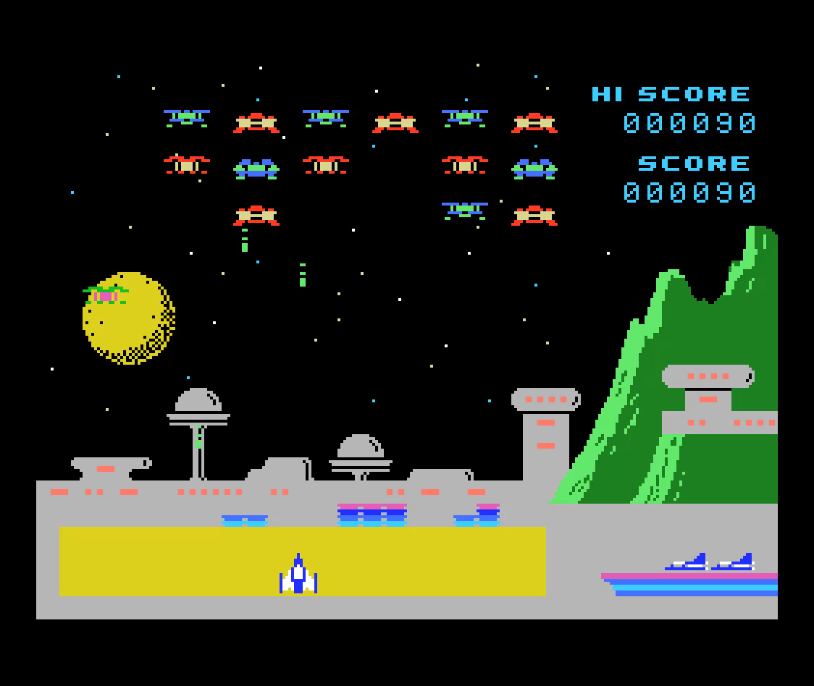</a>

Manual: [MANUAL.md](emu/vg8235/Distribution/MANUAL.md), project: [emu/vg8235](emu/vg8235/README.md)

[↑ Contents](#contents)

## 6. License

Except where explicitly stated otherwise, this repository is licensed as follows (details in [LICENSE.txt](LICENSE.txt)):

| Content | License |
| --- | --- |
| Software: source code, build scripts, firmware | [MIT](LICENSE.txt) |
| Hardware designs: schematics, PCB layouts, Gerber and drill files, bills of materials, GAL equations | [CERN-OHL-S-2.0](LICENSE-CERN-OHL-S-2.0.txt) |
| Documentation and images: READMEs, manuals, photos, screenshots, videos | [CC BY-SA 4.0](https://creativecommons.org/licenses/by-sa/4.0/legalcode) |

Third-party components keep their own licenses (listed in [LICENSE.txt](LICENSE.txt)). Original ROM images and third-party software images are not part of this repository.

[↑ Contents](#contents)
