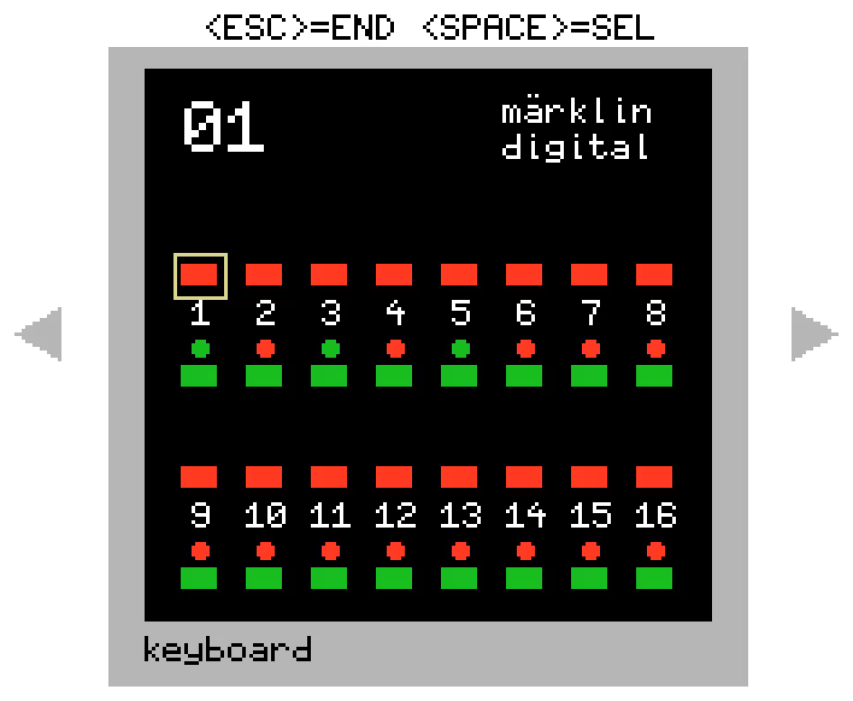
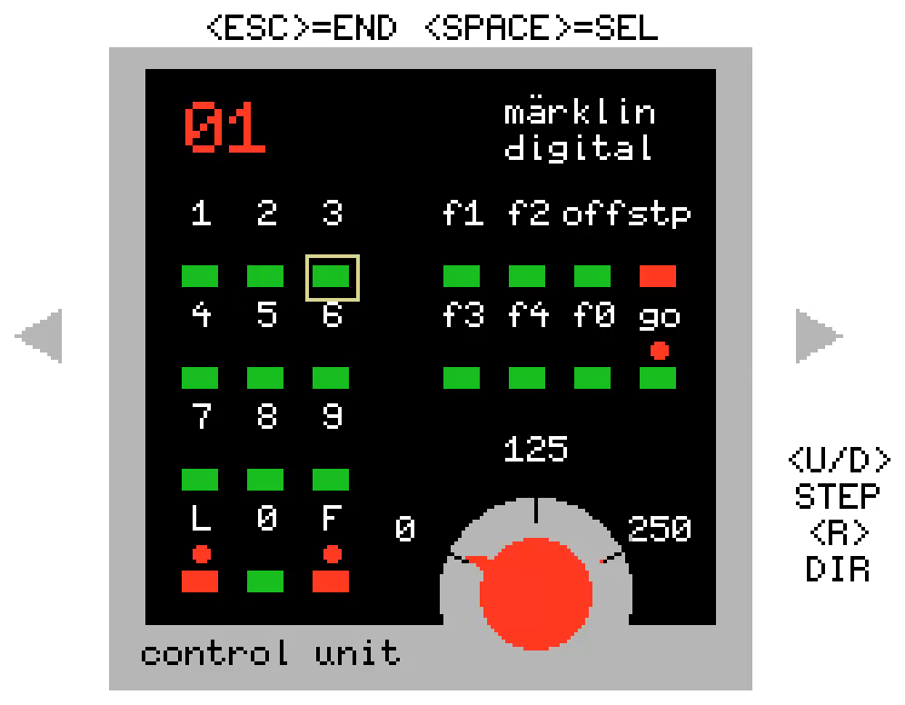
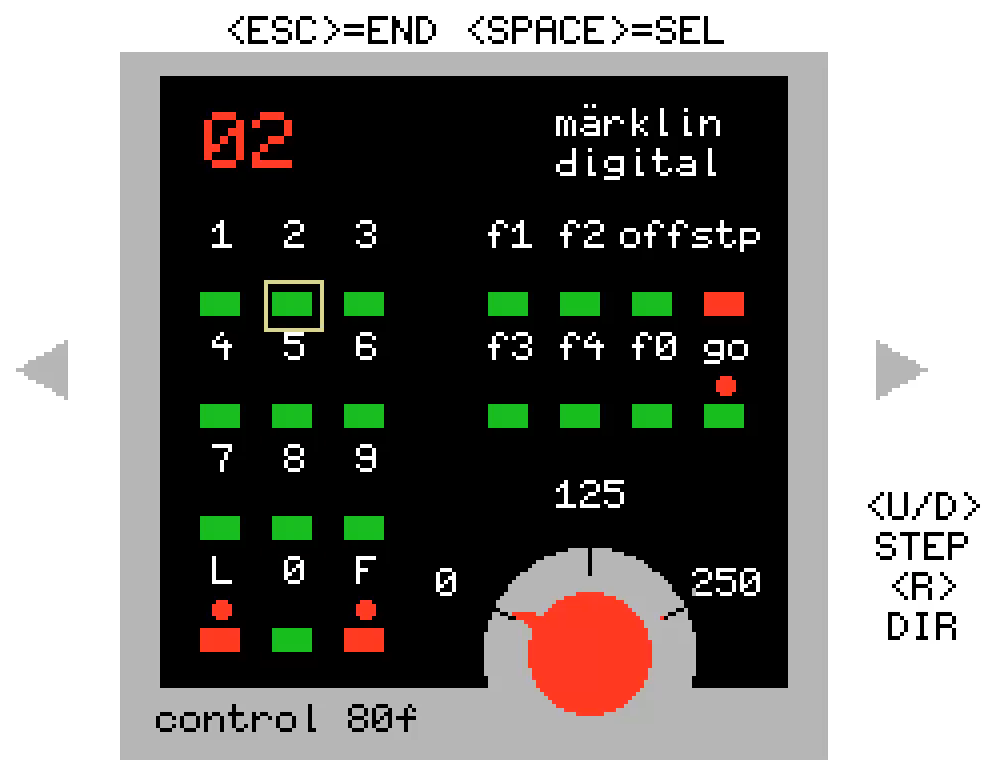
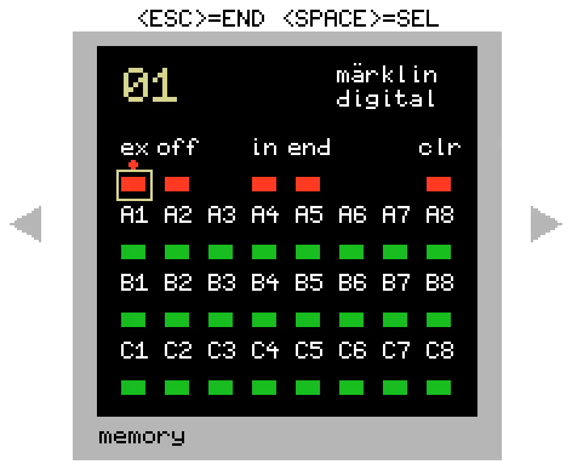

# mbc89 - Operating Manual

mbc89 turns an MSX into a Maerklin Connect6021 module on the CS2/CS3 CAN bus. Its panels stand in for
the devices of the old Maerklin 6021 system: Keyboard 6040, Control Unit 6021, Control 80f and
Memory 6043. Everything is operated with the MSX keyboard.

## 1. Starting

mbc89 needs MSX-DOS 2 and reads its settings from environment variables. Put them into a batch file,
for example `START.BAT`:

```bat
SET IO=4
SET INT=3
SET KEYB=3
SET C80F=4
SET MEMB=4
SET MEMV=1
SET S881=1
SET S882=4
SET S883=0
SET S884=0
MBC89
```

| Variable | Range | Meaning |
| --- | --- | --- |
| `IO` | 0-254 | I/O address of the CAN card (RC2014 card E) |
| `INT` | 0-7 | interrupt channel of the XIO cartridge |
| `KEYB` | 0-16 | number of Keyboard 6040 panels |
| `C80F` | 0-8 | number of Control 80f panels |
| `MEMB` | 0-4 | number of Memory 6043 panels |
| `MEMV` | 0-1 | route interlocking of all Memory panels (1 = on) |
| `S881`-`S884` | 0-93 | s88 module address of button row A of Memory 1-4, 0 = no feedback modules; needed for each Memory counted in `MEMB` |

If a variable is missing or out of range, mbc89 names it and returns to the DOS prompt.

After a splash screen, a boot screen shows the settings, the stored module data and the start of the
CAN card. About ten seconds later the panels appear. `ESC` quits mbc89.

On the first start the module still needs a GUiD: start ParaCenter and register mbc89 there,
otherwise the CS2/CS3 does not take it in.

## 2. Moving around

| Key | Effect |
| --- | --- |
| Cursor keys | move the frame from button to button |
| `SPACE` | presses the framed button |
| `ESC` | quits mbc89 |

All panels sit side by side on a carousel. The two triangles at the left and right edge are buttons as
well: frame one and press `SPACE` to move to the neighbouring panel. Order from left to right:

```
Memory 4 ... Memory 1 | Keyboard n ... Keyboard 1 | CU6021 | Control 80f 1 ... Control 80f n
```

mbc89 starts on the CU6021. The number in the top left corner shows which Keyboard (white) or
Memory (yellow) is on screen.

## 3. Keyboard 6040



Two blocks of 8 accessories (turnouts, signals), each with a red button on top and a green one below.
The dot between the two buttons is the LED: red or green shows the last switched direction.

- `SPACE` on a red or green button switches the accessory and lights the matching LED.
- The LEDs follow the CAN bus: an accessory switched on the CS2/CS3, by a Memory route or elsewhere
  shows up here too, even while another panel is on screen.
- Each Keyboard has its own block of 16 accessory addresses.
- While the system is stopped (see CU6021), the buttons do nothing.

## 4. Control Unit 6021 and Control 80f





Both control a locomotive. There is one CU6021; Control 80f panels work the same way and can control
further locomotives at the same time.

| Button / key | Effect |
| --- | --- |
| `1`-`9`, `0` | enter the locomotive address, two digits (01-80); a third digit starts a new address |
| `f1`-`f4` | switch function 1-4 on and off |
| `f0` / `off` | switch the light (function 0) on / off |
| `stp` / `go` | stop / start the whole layout |
| `U` / `D` (MSX keys) | speed one step up / down (15 steps) |
| `R` (MSX key) | change direction |

- A complete address blinks if the locomotive cannot be controlled: it is not known to the
  CS2/CS3, or another CU6021/Control 80f already holds it (a locomotive can only be called up on one
  controller at a time).
- When an address is entered, the panel takes over the current speed, direction and functions of the
  locomotive.
- While the layout is stopped, only `go` works; all other buttons on all panels do nothing.
- `L` and `F` have no function.
- The knob shows the speed. LEDs show the switched-on functions `f0`-`f4`, the direction (the dots at
  `L` and `F`) and, at `go`, that the layout is running; without a controllable locomotive they stay dark.

## 5. Memory 6043



The small dot above a button is its LED (in the picture: the dot above `ex` - this Memory is in
automatic mode).

A Memory stores up to 24 routes (A1-A8, B1-B8, C1-C8). A route is a list of up to 20 accessory
commands, recorded from the Keyboard panels. Routes are stored in `MBC89R.CFG` and survive a restart.

### 5.1 Recording a route

1. `in` - the `in` LED lights up.
2. Route button (for example `A1`).
3. Move to a Keyboard panel and switch the accessories of the route.
4. Back to the Memory, `end` - the `in` LED goes out.

During recording, `clr` removes the last command. Switching an accessory again replaces its earlier
command instead of adding a new one.

### 5.2 Calling up and releasing

| Action | Keys |
| --- | --- |
| set a route | route button - its LED lights up, the route is now valid |
| release a valid route | `clr`, then the route button (the `clr` LED lights while it waits; `end` cancels) |
| delete a route completely | `in`, `clr`, route button |

A valid route goes out by itself as soon as one of its accessories is switched the other way, on a
Keyboard, on the CS2/CS3 or by another route.

### 5.3 Interlocking (`MEMV=1`)

Two routes cross when they switch the same accessory in different directions.

- Without interlocking, every route is set at once; valid routes it crosses go out.
- With interlocking, a route that crosses a valid route of the same Memory is not set. Instead the
  crossing routes and the called one blink for about 5 seconds. Pressing one of the blinking routes
  sets it anyway; without a press the old route stays valid.
- A follow-up route that would cross a valid route is skipped.

### 5.4 Automatic mode with s88 feedback modules

`extern` switches a Memory to automatic mode, `off` back to manual (the `ex` / `off` LED shows which).
In automatic mode the route buttons still work; in addition, contacts of s88 feedback modules (mbc88,
mbc90) call up routes.

Each Memory uses three s88 modules, one per button row:

| Module address | Row | Contacts 1-8 | Contacts 9-16 |
| --- | --- | --- | --- |
| `S88x` | A | request route A1-A8 | release input A1-A8 |
| `S88x` + 1 | B | request route B1-B8 | release input B1-B8 |
| `S88x` + 2 | C | request route C1-C8 | release input C1-C8 |

- Without interlocking, a request sets the route at once; release inputs are not used.
- With interlocking:
  - Simultaneous requests are served in the order A1, A2, ... C8.
  - A request that cannot be set because of a crossing valid route is stored and set as soon as that
    route is released.
  - A release input releases its valid route when the contact is occupied, so that a crossing route
    can be set.
  - While a release input is occupied, a request for its route is ignored and not stored.

The s88 modules must be set up in ParaCenter with consecutive module addresses, like the three s88
behind a real Memory.

### 5.5 After a restart

Valid routes and the automatic/manual mode of each Memory are restored.

## 6. Files

| File | Content |
| --- | --- |
| `MBC89.CFG` | module data set in ParaCenter or on the CS2/CS3 (GUiD, name, mapping, keyboard base address, ...) |
| `MBC89R.CFG` | Memory routes, valid routes and automatic/manual mode |

Both files are written to the current drive.
