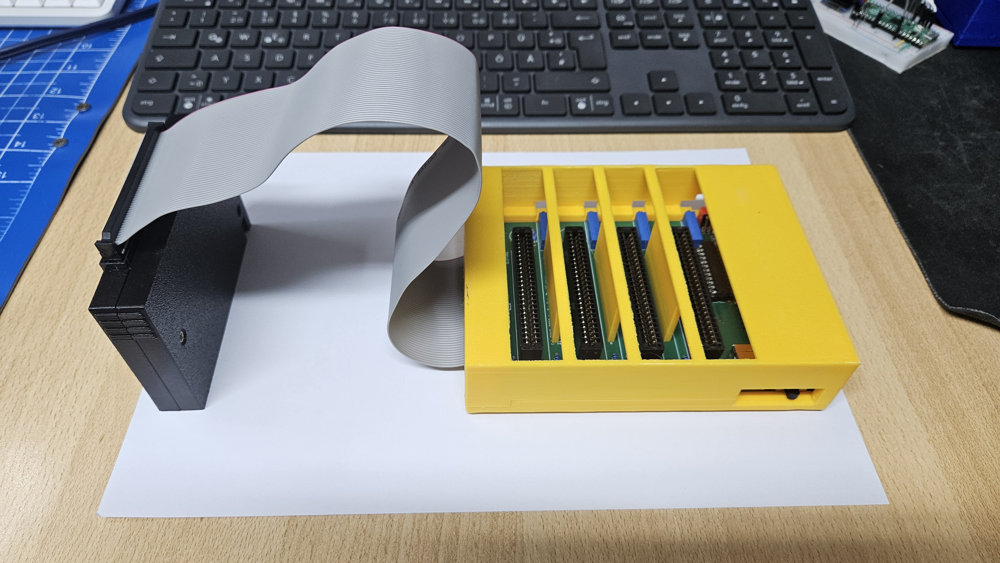

# Slot expander - four cartridge slots for one MSX slot

A slot expander for MSX computers: four cartridge slots behind one primary slot, as subslots 0-3 of
a standard MSX slot expander with its register at FFFFh. It sits outside the computer on a 50-wire
ribbon cable and has its own 5 V supply, so the cartridges in it do not load the power supply of the
MSX.

The expander connects to the MSX in one of two ways:

- **Spectravideo SVI-728:** the 50-pin box header of the expander follows the pinout of the
  SVI-728, so the ribbon cable goes straight to the SVI-728.
- **Any other MSX:** plug the Slot2Bus adapter into a cartridge slot. It takes the 50 contacts of
  the slot 1:1 to its box header, and the ribbon cable goes from there to the expander.

Tested on a Spectravideo SVI-728.

## Contents of this folder

| Path | Content |
| --- | --- |
| [pcb/expander](pcb/expander) | Eagle project of the expander: schematic `msx_slot_expander.sch`, layout `msx_slot_expander.brd`; bill of materials `msx_slot_expander_bom.csv` |
| [pcb/expander/gerber](pcb/expander/gerber) | Gerber RS-274X and Excellon drill files of the two-layer board, also as `msx_slot_expander_gerber.zip` for the PCB maker |
| [pcb/adapter](pcb/adapter) | Eagle project of the Slot2Bus adapter: `msx_slot2bus_expander.sch`, `msx_slot2bus_expander.brd`; bill of materials `msx_slot2bus_expander_bom.csv` |
| [pcb/adapter/gerber](pcb/adapter/gerber) | Gerber and drill files of the adapter, also as `msx_slot2bus_expander_gerber.zip` |
| [gal](gal) | GAL equations (WinCUPL) and programming files: `FPGA_EXP_ADR_BANKING` (GAL22V10), `FPGA_EXP_IO_CTRL` (GAL16V8) |
| [case](case) | 3D-printable enclosures as FreeCAD files: expander `MSX_EXPANDER_BOTTOM/TOP.FCStd`, adapter `MSX_CARD_SLOT2BUS_BOTTOM/TOP.FCStd` |
| [media](media) | Photo |

## 1. How it works

| Function | Implementation |
| --- | --- |
| Subslot register FFFFh | Two 74HCT30 detect the address FFFFh. The GAL22V10 `FPGA_EXP_ADR_BANKING` stores the value written to FFFFh while the slot is selected and returns it inverted on a read, as the MSX standard requires. |
| Subslot select | For each memory access, the GAL22V10 picks the two register bits of the page given by A15/A14. The GAL16V8 `FPGA_EXP_IO_CTRL` turns them into /SLTSL of subslot 0-3; accesses to FFFFh itself do not select a subslot. |
| Subslots on and off | DIP switch S101 connects each subslot select to its slot. Open, the subslot stays empty for the MSX. |
| /INT and /BUSDIR | Each slot reaches the line of the MSX through a diode, with a pull-up on the expander. |
| Sound | The sound output of each slot goes through its own 10 kOhm trimmer to the sound input of the MSX, so the level of each cartridge can be set. |
| Power | 5 V through a USB type B socket, a ferrite bead and the power switch; +12 V and -12 V for the slots from a DC-DC converter NMA0512. The 5 V of the MSX only light the LED "MSX". |

| LED | Meaning |
| --- | --- |
| MSX | the MSX is switched on (5 V on the ribbon cable) |
| EXP | the expander is switched on |

## 2. Hardware

- Order the boards with the zip files in `pcb/expander/gerber` and `pcb/adapter/gerber`. Check the
  layers in a Gerber viewer (for example the online viewer of the PCB maker) before you order. The
  parts are listed in the two bill-of-materials files.
- Program the GALs with `gal/FPGA_EXP_ADR_BANKING.jed` (GAL22V10) and `gal/FPGA_EXP_IO_CTRL.jed`
  (GAL16V8).
- The two LEDs have no series resistor on the board; use LEDs with a built-in resistor for 5 V.
- The ribbon cable has 50 wires with an IDC socket at each end. Mind pin 1 at both ends.
- Supply: a USB power supply with 5 V and enough current for the cartridges plugged in. The
  cartridges are powered by the expander, not by the MSX: with the expander switched off, they do not
  work.
- Switch on the expander first, then the MSX.
- No hot plug, just like a real MSX: change cartridges only with the expander and the MSX switched
  off.

## 3. Enclosures

`case` holds two-part enclosures as FreeCAD files, built with FreeCAD 1.0 (PartDesign):

| Files | Part | Size (outside) |
| --- | --- | --- |
| `MSX_EXPANDER_BOTTOM.FCStd`, `MSX_EXPANDER_TOP.FCStd` | expander | 150 x 115 mm; bottom part 10 mm, top part 30 mm high |
| `MSX_CARD_SLOT2BUS_BOTTOM.FCStd`, `MSX_CARD_SLOT2BUS_TOP.FCStd` | Slot2Bus adapter, cartridge shaped | 111 x 68 mm; bottom part 11 mm, top part 15 mm high |

Only the design files are included, no STL or G-code, so the enclosures can be adapted before
printing:

1. Open the files in FreeCAD 1.0 or newer and change the sketches as needed; the following features
   update automatically.
2. Select the body and export it as STL or 3MF (File > Export).
3. Slice the file for your printer as usual.

## 4. License

The parts in this folder follow the [license of this repository](../README.md#9-license): the
boards, the GAL equations and the enclosures CERN-OHL-S-2.0, documentation and photo CC BY-SA 4.0.
