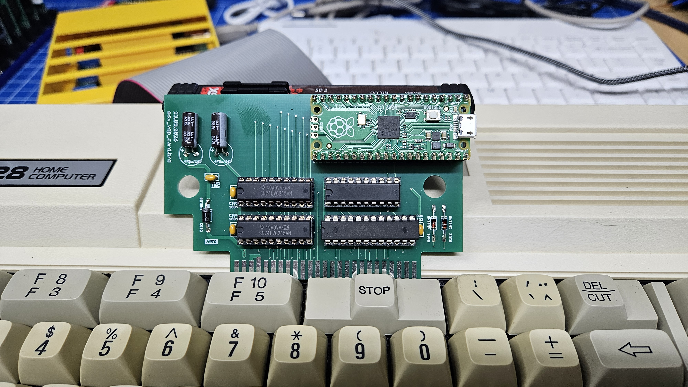
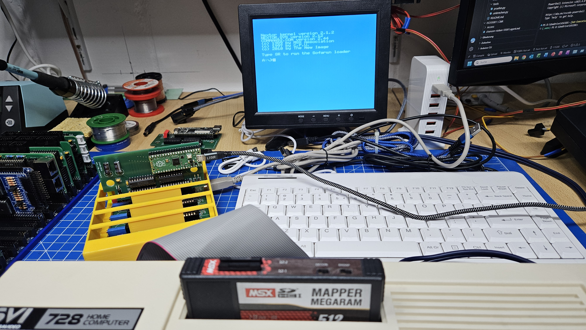
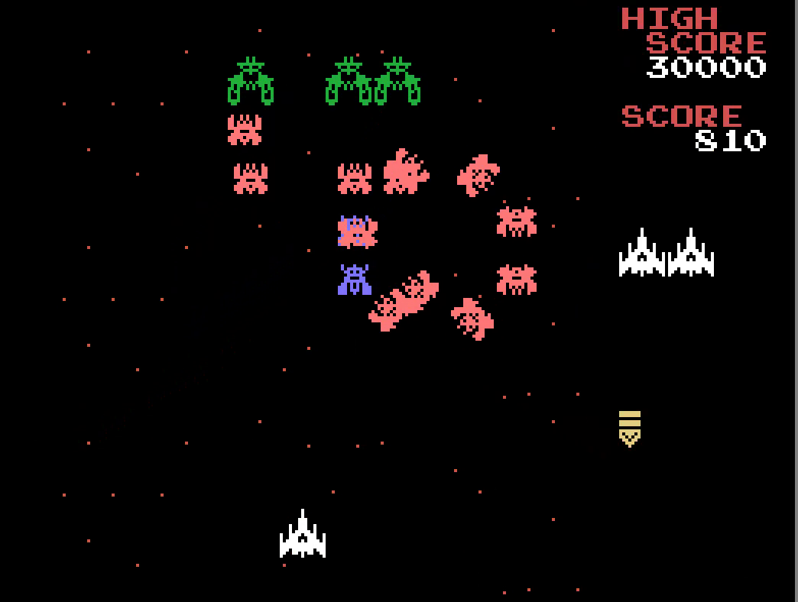

# TMS9918A - the MSX1 picture on the PC screen

A small debugging card for a cartridge slot of a real MSX1 and a passive, exact emulation of its
video display processor (VDP), the TI TMS9918A, on a Windows PC. It was made for development work:
instead of a second monitor or an old CRT on the desk, the picture of the real MSX appears in a
window on the PC, sharp and flicker-free, next to the editor, the assembler and the other tools on
the same screen.

The emulator does not run any MSX software itself. A Raspberry Pi Pico on the card listens to every
access of the Z80 to the VDP (ports 98h/99h) and sends it to the PC over USB. The emulator replays
these accesses on its own TMS9918A model and shows the resulting picture. The MSX keeps running at
full speed with its own VDP; the card only listens.

Because the Pico also captures the values the real VDP returns on reads (VRAM data and status
register), every read checks the model against the real chip. The status display counts and logs all
mismatches, so the emulation is measurable rather than just "looks right".

```text
 MSX (Z80 + real VDP)          Raspberry Pi Pico               PC
 ports 98h/99h  ── slot ──►  PIO capture, time stamps  ── USB ──►  TMS9918A emulator
                ◄─ /RES ───  reset on request          ◄─ "7" ───  (VB.NET, Windows)
```

Tested on a Spectravideo SVI-728 (TMS9929A, PAL) with MSX BASIC, Nextor, SofaRun and games: no
mismatches in VRAM reads and status reads.





**Video: an SVI-728 from power-on to GALAGA.** Recorded with the video recording of the emulator:
the start with the SD card driver of the cartridge, Nextor, SofaRun and a round of GALAGA. Nothing
of it comes from the video output of the MSX; every picture is rebuilt from the VDP accesses the
card has captured. Click the picture to open the video.

[](media/TMS9918A_SVI728_Galaga.mp4)

## Contents of this folder

| Path | Content |
| --- | --- |
| [bin](bin) | Ready-to-run emulator for Windows x64: `TMS9918A.exe` with `TMS9918AVideo.dll` |
| [TMS9918A](TMS9918A) | Emulator source, Visual Basic .NET (Windows Forms, .NET Framework 4.5) |
| [TMS9918AVideo](TMS9918AVideo) | Native DLL (C++, x64) for the video recording, built on [emu/chips/VIDEOREC](../emu/chips/VIDEOREC) |
| `TMS9918A.sln` | Visual Studio solution |
| [TMS9918aPiPico](TMS9918aPiPico) | Raspberry Pi Pico firmware (Arduino-Pico core, PIO), see its [README](TMS9918aPiPico/README.md) |
| `TMS9918aPiPico.ino.uf2` | Ready-to-flash firmware |
| [pcb](pcb) | Eagle project of the card: schematic `msx_vdp_slot.sch`, layout `msx_vdp_slot.brd`; bill of materials `msx_vdp_slot_bom.csv`; photos |
| [pcb/gerber](pcb/gerber) | Gerber RS-274X and Excellon drill files of the two-layer board, also as `msx_vdp_slot_gerber.zip` for the PCB maker |
| [pcb/gal](pcb/gal) | GAL22V10 equations `FPGA_IO.PLD` (WinCUPL) and the programming file `FPGA_IO.jed` |
| [media](media) | Video: an SVI-728 from power-on to GALAGA |
| [DATA_FORMATS.md](DATA_FORMATS.md) | USB protocol, synchronisation, VDP ports, registers and the comparison rules |

Main source files of the emulator:

| File | Content |
| --- | --- |
| `clVDP.vb` | TMS9918A model: ports, registers, VRAM, line renderer, sprites, status, time base |
| `clCOM.vb` | COM port, receive thread, line parser, ring buffer, settings file |
| `clVIDEO.vb` | Video recording: interface to `TMS9918AVideo.dll` |
| `frmMain.vb` | Main window: message processing, picture output, status display |
| `frmInit.vb` | Settings dialog (COM port) |
| `UiText.vb` | Language of the user interface |

## 1. Features

- Port state machine of the TMS9918A: address latch, 14-bit address, read-ahead buffer, 4K and 16K
  mode with the 4K DRAM address mapping.
- All screen modes including the undocumented mixed modes, sprites with size, magnification, early
  clock, 4-per-line limit, fifth-sprite and collision flags.
- Line-accurate timing from the sender's time marks: every display line is built from the VRAM and
  register state valid at its time, so changes in the middle of the frame show up where they happen.
- PAL/NTSC detection and frame position tracking from the real VDP's F flag only (interrupts of
  other cartridges do not disturb).
- Comparison of every VRAM read and status read with the real VDP; the first mismatches are logged
  in the status display.
- Reset of the MSX from the PC: Connection > Connect resets the MSX, its RESET message synchronises
  the emulator.
- Video recording of the picture to MP4 (H.264), starting with a reset of the MSX.
- User interface in English or German (System > English / Deutsch).

## 2. Hardware

- An MSX1 with a TMS9918A family VDP (TMS9918A, TMS9928A, TMS9929A).
- The card in this folder: a Raspberry Pi Pico, a GAL22V10 that decodes the VDP ports and produces
  /CSW, /CSR and an address signal for ports 98h/99h, two 74LVC245 that shift the bus signals to
  3.3 V and a 74HCT245 that drives /WAIT and the reset of the MSX. Diodes let the 74HCT245 pull these
  two lines only LOW. The pin assignment is listed in the firmware [README](TMS9918aPiPico/README.md).
- Program the GAL with `pcb/gal/FPGA_IO.jed`.
- The Pico is powered by the MSX through the Schottky diode D103 on VSYS. The Pico can also draw
  power from USB, but D103 keeps the USB port from feeding the MSX.
- While the firmware is not running (power-up, BOOTSEL, flashing), the Pico holds the MSX in reset.
  This is intended: the MSX starts only when the card is ready.
- No hot plug, just like any MSX cartridge: plug in the card only with the MSX switched off.
- To order the board, upload `pcb/gerber/msx_vdp_slot_gerber.zip` to the PCB maker. Check the layers
  in a Gerber viewer (for example the online viewer of the PCB maker) before you order. The parts
  are listed in `pcb/msx_vdp_slot_bom.csv`.

## 3. Firmware

- Easiest way: hold the BOOTSEL button of the Pico while connecting it to the PC, then copy
  `TMS9918aPiPico.ino.uf2` to the drive `RPI-RP2` that appears.
- Or build it yourself with the Arduino-Pico core (earlephilhower), board "Raspberry Pi Pico":

  ```text
  arduino-cli compile --fqbn rp2040:rp2040:rpipico TMS9918aPiPico
  arduino-cli upload  --fqbn rp2040:rp2040:rpipico -p <COM port> TMS9918aPiPico
  ```

The emulator must not have the COM port open while the Pico is flashed.

## 4. Emulator

The program needs Windows 10/11 x64 and the .NET Framework 4.5 or newer (part of Windows). Copy the
folder `bin` anywhere and start `TMS9918A.exe`.

To build it yourself, open `TMS9918A.sln` in Visual Studio 2022 (workloads .NET desktop and C++)
and build, or on the command line:

```text
MSBuild.exe TMS9918A.sln /t:Rebuild /p:Configuration=Release
```

The program is `TMS9918A/bin/Release/TMS9918A.exe`. Before its own build, the emulator project
builds `TMS9918AVideo.dll` (x64) with the shared VIDEOREC library from `../emu/chips` and copies it
next to the program; the C++ intermediate files go to `Build/`.

## 5. Usage

1. Plug the card with the Pico into the MSX and connect the Pico to the PC over USB. While the
   firmware is starting, the Pico holds the MSX in reset.
2. Start `TMS9918A.exe`, choose the Pico's COM port under Connection > Settings.
3. Connection > Connect resets the MSX. As soon as its RESET message arrives, the emulator is
   synchronised and shows the picture.
4. The status display on the right shows the throughput, the VDP registers and tables, the time base
   (PAL/NTSC) and the counters and first entries of VRAM and status mismatches.

The settings (COM port, language and video standard) are stored in `Inifiles/tms9918a_init.txt`
next to the program.

## 6. Video recording

1. Choose the video standard of the MSX under System > Video PAL (50 Hz) or Video NTSC (60 Hz). The
   frame rate of the video follows this choice, not the standard detected from the stream: that one
   is unknown again after every reset of the MSX.
2. Connect to the MSX, then System > Record video... and choose the file. Recording is possible only
   while connected.
3. Right after the start the emulator resets the MSX. The video begins with its RESET message, so
   every recording shows the machine from power-on.
4. System > Stop video, Disconnect or closing the program finishes the file. The status bar shows
   `REC m:ss` while recording.

The video shows the picture as in the window (magnified, with the border) at the frame rate of the
VDP (50.16 or 59.92 Hz) and has a silent sound track, since the VDP has no sound. Frames are timed
by the VDP, not by the PC, so the video runs at the speed of the real MSX. The suggested folder is
`Documents\TMS9918A\VIDEO`.

## 7. Limits

- The status register is compared only where the real chip defines it. In text mode and with the
  display blanked the real VDP returns an undefined sprite number with 5S set; without 5S the sprite
  number shows the progress of the sprite check at the time of the read. Details are in
  [DATA_FORMATS.md](DATA_FORMATS.md).
- The time marks have a resolution of 1 µs and are sent at most every 64 µs, so a read is placed to
  within a line, not to within a pixel.
- Only the IO traffic to the VDP is seen; the picture is rebuilt from it, not captured from the
  video output. MSX2 machines (V9938) are not supported.

## 8. Sources

- Texas Instruments, TMS9918A/TMS9928A/TMS9929A Video Display Processors Data Manual
- Sean Young, TMS9918A description including undocumented features

## 9. License

The parts in this folder follow the [license of this repository](../README.md#8-license): software
MIT, the card (schematic, layout, Gerber and drill files, bill of materials, GAL equations)
CERN-OHL-S-2.0, documentation, photos and video CC BY-SA 4.0.
