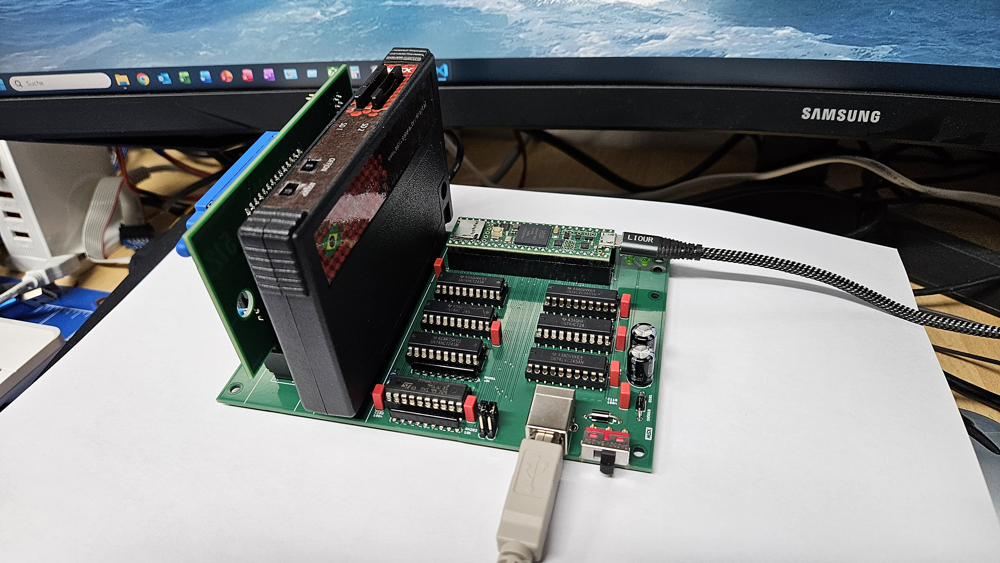
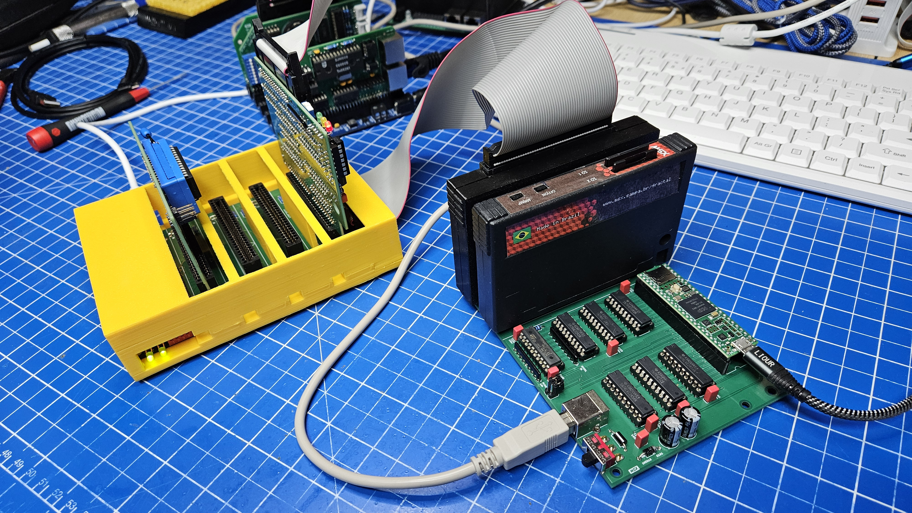
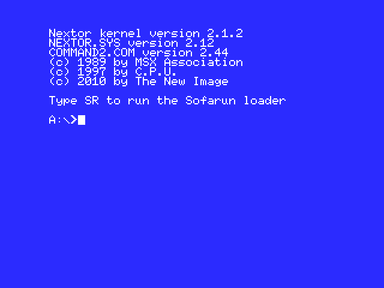
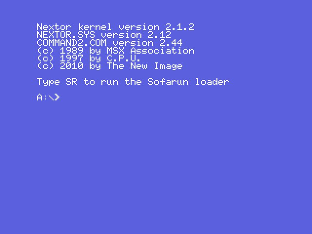

# USB2SLOT - real MSX cartridges in openMSX

USB2SLOT connects real MSX cartridges to the openMSX emulator on a Windows PC. A Teensy 4.1 on a small board
with two MSX cartridge slots generates the MSX clock and runs genuine Z80 bus cycles on the cartridges. openMSX
gets a new device, `USBSlot`, that forwards every memory and I/O access of its slot over USB to the board.

Tested with ROM cartridges (RCX, XIO), a cartridge with its own slot expander, the SD Mapper/Megaram 512K
cartridge (Nextor boots from its SD card, Memory Mapper and MegaRAM mode) and the RC2014 cards behind the RCX/XIO
cartridges (I/O, /INT and /WAIT), on emulated Spectravideo SVI-728 and Philips VG-8235 machines.





**Videos: booting Nextor from a real cartridge.** Both machines are emulated by openMSX, the cartridge is real: the SD Mapper/Megaram 512K sits in slot 2 of the board, and openMSX reaches it only over USB. From power-on, the machine scans its slots, finds the Nextor ROM of the cartridge, loads NEXTOR.SYS and COMMAND2.COM from the SD card of the cartridge and stops at the `A:\>` prompt. The videos were recorded in emulated time, so they run at the speed of a real MSX. With firmware protocol 3 the PC is faster than that: openMSX reaches the prompt of the VG-8235 after about 6 seconds, because the SD card sectors come over USB in one block each (see [CARTRIDGE_PROFILES.md](CARTRIDGE_PROFILES.md)). Click a picture to open the video.

Philips VG-8235 (MSX2), prompt after 18 seconds

[](media/USB2SLOT_VG8235_Nextor.mp4)

Spectravideo SVI-728 (MSX1), prompt after 17 seconds

[](media/USB2SLOT_SVI728_Nextor.mp4)

## Contents of this folder

| Folder | Content |
| --- | --- |
| [pcb](pcb) | Eagle project of the board: schematic `msx_usb2slot.sch`, layout `msx_usb2slot.brd`; bill of materials `msx_usb2slot_bom.csv`; photos |
| [case](case) | 3D-printable enclosure, bottom and top part as FreeCAD files `MSX_USB2SLOT_BOTTOM.FCStd` and `MSX_USB2SLOT_TOP.FCStd` |
| [pcb/gerber](pcb/gerber) | Gerber RS-274X and Excellon drill files of the two-layer board, also as `msx_usb2slot_gerber.zip` for the PCB maker |
| [firmware](firmware) | Teensy firmware `BridgeTeensy/BridgeTeensy.ino` and the ready-to-flash `BridgeTeensy.ino.hex` |
| [slotlink](slotlink) | PC library `slotlink.h` (Win32) and the test tool `slottest.exe` with its source |
| [openmsx](openmsx) | The `USBSlot` device (`USBSlot.cc/.hh`), start script, extensions, build scripts |
| [media](media) | Videos: start of a VG-8235 and an SVI-728 to the Nextor prompt |
| [CARTRIDGE_PROFILES.md](CARTRIDGE_PROFILES.md) | Recipe for cartridges with their own logic (slot expander, bank registers, SPI ports): detection, cache rules, block reads, measuring; worked example SD Mapper |
| [openmsx/bin](openmsx/bin) | Ready-to-run openMSX 21.0 for Windows x64 with the `USBSlot` device built in |

## 1. Hardware

- Teensy 4.1, two 50-pin MSX cartridge slots, level shifters 74HCT245 (Teensy to slot, 5 V) and 74LVC245 (slot to
  Teensy, 3.3 V); the data bus has one write path (74HCT245) and one read path (74LVC245).
- Power: external 5 V supply, at least 2 A (300 mA per slot plus Teensy and level shifters). +12 V and -12 V for the
  slots come from a DC-DC module. The Teensy is fed from the slot supply through a Schottky diode on VIN, so it
  stays powered whenever the slots are.
- If VIN and VUSB of the Teensy are connected (check with a continuity tester), the slot supply can feed current
  into the USB port of a switched-off PC. Keep that in mind when the PC is off and the cable stays plugged in.
- Jumper JP201: open for normal use. 1-2 connects the Teensy test line to /WAIT, 3-4 to /INT; both are only for
  the self test of the board (see section 3).
- No hot plug, just like a real MSX: change cartridges only with the board switched off.
- To order the board, upload `pcb/gerber/msx_usb2slot_gerber.zip` to the PCB maker. Check the layers in a Gerber
  viewer (for example the online viewer of the PCB maker) before you order. The parts are listed in
  `pcb/msx_usb2slot_bom.csv`.

### Enclosure

`case` holds a two-part enclosure for the board (outside 150 x 115 mm; bottom part 10 mm, top part
30 mm high) as FreeCAD files, built with FreeCAD 1.0 (PartDesign: sketches, pads, pockets). Only the
design files are included, no STL or G-code, so the enclosure can be adapted, for example to other
cartridges, a different supply socket or another printer, before printing:

1. Open `MSX_USB2SLOT_BOTTOM.FCStd` and `MSX_USB2SLOT_TOP.FCStd` in FreeCAD 1.0 or newer and change the
   sketches as needed; the following features update automatically.
2. Select the body and export it as STL or 3MF (File > Export).
3. Slice the file for your printer as usual.

## 2. Firmware

The firmware runs on a Teensy 4.1 (USB type "Serial", CPU speed 600 MHz).

- Easiest way: open `firmware/BridgeTeensy.ino.hex` in the Teensy Loader (part of Teensyduino) and press the
  button on the Teensy.
- Or build it yourself with the Teensy core (`teensy:avr`):

  ```text
  arduino-cli compile --fqbn teensy:avr:teensy41:usb=serial,speed=600 --output-dir build firmware/BridgeTeensy
  arduino-cli upload  --fqbn teensy:avr:teensy41:usb=serial,speed=600 --input-dir build -p <COMx> firmware/BridgeTeensy
  ```

After flashing, the Teensy appears as a serial port (COM port). Look up its number in the Windows Device Manager;
all examples below use `COM16`.

The firmware speaks binary protocol version 3 (spaced block reads `MRDNG` for ports that need time per byte).
openMSX and `slottest` of this folder also accept a board with protocol 2; then the SD card of the SD Mapper is
read byte by byte, as before, and much slower. After an update of this folder, flash the new `.hex` as well.

## 3. Check the board

`slotlink/slottest.exe` talks to the board directly (rebuild it with `slotlink/build.cmd`, Visual Studio 2022):

```text
slottest COM16 hello       version and state of the board
slottest COM16 scan        what is plugged in: slot expander, ROM/data/empty per subslot, Nextor driver name, I/O ports
slottest COM16 selftest    protocol self test
slottest COM16 dump 1 4000 4000 rom.bin    read 16 KB from slot 1, address 4000h, into rom.bin
```

`slottest` without parameters lists all commands. The self test checks /INT and /WAIT through jumper JP201; with
the jumper open those two checks fail, all others must pass.

## 4. Start openMSX with the board

Requirements: Windows 10/11 x64 and Python 3. No installation of openMSX is needed; `openmsx/bin` is a complete
openMSX 21.0.

```text
openmsx\start_usbslot.cmd [machine] [--port COMx] [--bridge 1|2|12] [more openMSX parameters]
```

The script first asks the board what is plugged in (`slottest scan`), writes matching extensions to
`Documents\openMSX\share\extensions` (`USBSlotAuto1`, `USBSlotAuto2`, `USBSlotAutoIO`) and then starts
`openmsx\bin\openmsx.exe` with them. It detects:

- a cartridge without slot expander,
- a cartridge with its own slot expander (contents of each subslot),
- the SD Mapper/Megaram 512K cartridge, either as Memory Mapper (ports FCh-FFh) or as MegaRAM (ports 8Eh/8Fh);
  only when ROM bank 7 holds the Nextor driver "SDMapper Driver", otherwise it counts as a plain slot expander,
- RCX/XIO cartridges with switched I/O on ports 40h-47h.

Examples:

```text
openmsx\start_usbslot.cmd
openmsx\start_usbslot.cmd Spectravideo_SVI-728 --port COM5
openmsx\start_usbslot.cmd Philips_VG_8235-00 --bridge 1 -cartb game.rom
```

- `--port`: COM port of the board, default `COM16` (or the environment variable `USBSLOT_PORT`).
- `--bridge 1`, `2` or `12`: use only these slots of the board (see next section).
- Without a machine name the script uses `C-BIOS_MSX2+_JP`.

### Mixing real and emulated cartridges

Real cartridges on the board and cartridges emulated by openMSX (ROM images, openMSX extensions) can run side by
side in one machine.

- Each slot of the board takes one free cartridge slot of the emulated machine. The switched I/O ports 40h-47h
  (`USBSlotAutoIO`) take no slot.
- All parameters that are not for the script itself (`-carta`, `-cartb`, `-exta`, `-ext`, ...) are passed to
  openMSX before the board's extensions. openMSX fills these fixed slots first; the slots of the board get the
  slots that are still free.
- A machine with two cartridge slots has no free slot left when both slots of the board are in use. Then
  `--bridge 1` or `--bridge 2` takes only one slot of the board into the emulation and leaves the other machine
  slot for the emulated cartridge. The script reports a board slot it leaves out as "nicht eingebunden".

Examples:

```text
rem ROM image in machine slot 1, the cartridge in slot 1 of the board in machine slot 2
openmsx\start_usbslot.cmd Spectravideo_SVI-728 --bridge 1 -carta game.rom

rem openMSX extension (1 MB Memory Mapper) in one machine slot, slot 2 of the board in the other
openmsx\start_usbslot.cmd Philips_VG_8235-00 --bridge 2 -ext ram1mb
```

`slotmap` in the openMSX console shows which cartridge ended up in which slot.

### Machines and system ROMs

The cartridges themselves need no ROM files: their ROMs sit on the real cartridges. The emulated machine does:

- C-BIOS (free, part of openMSX) works out of the box, but it has no MSX-BASIC. BASIC programs and CALL commands
  of cartridges (e.g. `_RCX`, `_XIO`) need a real machine.
- For real machines such as the Spectravideo SVI-728 or the Philips VG-8235, copy your own dumps of the system ROMs
  to `Documents\openMSX\share\systemroms`. openMSX finds them by their SHA1 checksum. System ROMs are not part of
  this repository.

### Behaviour during emulation

- Every slot access of the emulated CPU goes to the real cartridge. A read cache keeps ROM contents on the PC, so
  ROM software runs in real time; I/O ports and areas marked `<nocache>` are always accessed directly.
- SD Mapper: the Nextor ROM is cached as long as the SPI port of the SD cards is switched off (6001h). The driver
  reads a sector with 512 `LDI` (a card register with 16); the bridge reads the bytes that chain will take in one
  block, 24 clocks apart, as the SPI logic of the cartridge needs it.
- /INT of the cartridges reaches the emulated CPU. /WAIT of memory reads and of I/O cycles is added to the
  emulated time.
- While openMSX runs, it sends a heartbeat to the board. When the emulation stops for more than 200 ms (pause,
  debugger), the board switches the cartridges off like a powered-down MSX; on resume openMSX notices this and
  resets the machine.
- If the USB connection breaks, the slot reads FFh until the next reset of the machine; the reset reconnects.

## 5. Extensions written by hand

`openmsx/extensions` holds fixed extensions for manual use (copy them to `Documents\openMSX\share\extensions`,
`openmsx/apply.py` does this as well). They contain the COM port in `<port>`; adjust it to your board.

| Extension | Content |
| --- | --- |
| `USBSlot1`, `USBSlot2` | slot 1 or 2 of the board, plain cartridge |
| `USBSlot1_Expander` | slot 1 with a cartridge that has its own slot expander |
| `USBSlot1_SDMapper`, `USBSlot2_SDMapper` | SD Mapper/Megaram 512K as Memory Mapper |
| `USBSlot2_SDMegaRAM` | SD Mapper/Megaram 512K as MegaRAM |
| `USBSlotIO40` | I/O ports 40h-47h (switched I/O) of the cartridges on the board |

Start example: `openmsx\bin\openmsx.exe -machine Spectravideo_SVI-728 -ext USBSlot1 -ext USBSlotIO40`

Rules inside `<USBSlot>` that tell the read cache how the cartridge switches its memory:

| Rule | Effect |
| --- | --- |
| `<expander>true</expander>` | the cartridge has its own slot expander (register FFFFh); rules per subslot in `<subslot id="0..3">` |
| `<nocache base=".." size=".."/>` | area is always read directly (registers, status, ports) |
| `<nocacheswitch address="0x6001" base="0x4000" size="0x0801"/>` | area is read directly only while bit 0 of the last write to the address is set (SD Mapper: SPI port instead of the Nextor ROM) |
| `<spiblock start="0x4001" end="0x41FF" gap="24"/>` | when an `LDI` of the cartridge's ROM reads `start` through the switched port, the bytes of the `LDI` that follow it in the code (at most up to `end`) are read in one block, `gap` clocks per byte (protocol 3) |
| `<bank page="1" address="0x6000" mask="0x07"/>` | a write to the address selects the ROM bank of the page |
| `<mapper port="0xFC" mask="0x1F"/>` | Memory Mapper RAM, segments selected by ports FCh-FFh |
| `<megaram port="0x8E"/>` | MegaRAM with four 8 KB bank registers, switched by ports 8Eh/8Fh |

## 6. Build openMSX yourself

Needed: Visual Studio 2022 (C++ workload), Git, Python 3.

```text
git clone --branch RELEASE_21_0 https://github.com/openMSX/openMSX.git C:\openMSX-21.0
cd C:\openMSX-21.0
python build\thirdparty_download.py windows
<this folder>\openmsx\build3rd.cmd C:\openMSX-21.0
python <this folder>\openmsx\apply.py C:\openMSX-21.0
<this folder>\openmsx\buildomsx.cmd C:\openMSX-21.0
```

- `apply.py` copies `USBSlot.cc/.hh` and `slotlink/slotlink.h` to `src/memory`, adds the device to
  `src/DeviceFactory.cc` and to the MSVC project, and installs the extensions. Running it twice changes nothing.
- The build scripts expect Visual Studio 2022 Community; for another edition adjust the path to `vcvars64.bat`.
- The result is `derived\x64-VC-Release\install\openmsx.exe`. Copy it to `openmsx\bin`, or point the start script
  to it with the environment variables `USBSLOT_OPENMSX` (path of `openmsx.exe`) and `USBSLOT_SHARE` (path of the
  `share` folder of an openMSX 21.0 installation).

## 7. Limitations

- Windows only (the USB connection uses the Win32 API).
- /M1 reaches the cartridge only in areas marked `<nocache>`; cached instructions never appear on the bus.
- /WAIT during memory writes is not added to the emulated time (no cartridge known to need it).
- Cartridges with an unknown slot expander or mapper run without switching rules; the cache then may show stale
  contents after a bank switch. Add matching rules to the extension.
- Uncached accesses take a USB round trip of about 100 microseconds. With firmware protocol 3 the SD card of the SD
  Mapper is about as fast as on a real MSX (`dir` in openMSX 4 s instead of 15 s byte by byte); cached ROM code runs in real
  time. Other cartridges with ports that need time per byte need their own profile, see
  [CARTRIDGE_PROFILES.md](CARTRIDGE_PROFILES.md).
- Not tested yet: game cartridges with their own mapper (Konami, ASCII, SCC), FM-PAC.

## 8. License

The parts in this folder follow the [license of this repository](../README.md#9-license): software MIT, the board
and the enclosure CERN-OHL-S-2.0, documentation CC BY-SA 4.0.

`openmsx/bin` is openMSX 21.0 (GNU General Public License version 2, see `openmsx/bin/doc/GPL.txt`) with the
`USBSlot` device built in, including C-BIOS (see `openmsx/bin/doc/cbios.txt`). Its complete source is openMSX
21.0 (https://github.com/openMSX/openMSX, tag `RELEASE_21_0`) plus the files in `openmsx` and `slotlink`, combined
with `openmsx/apply.py` as described in section 6.
